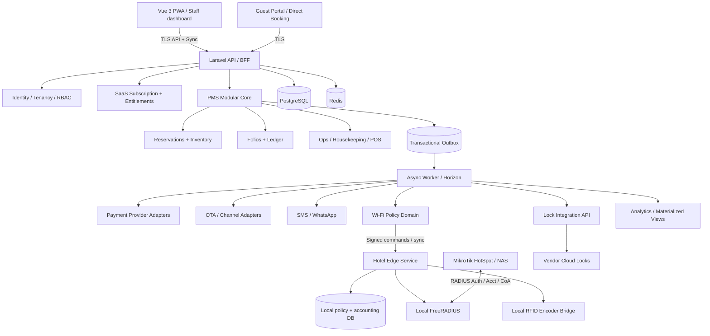
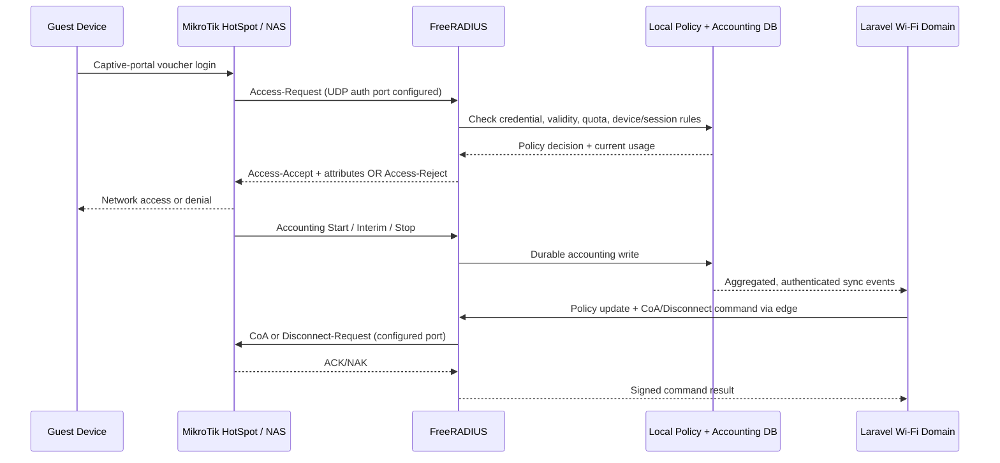
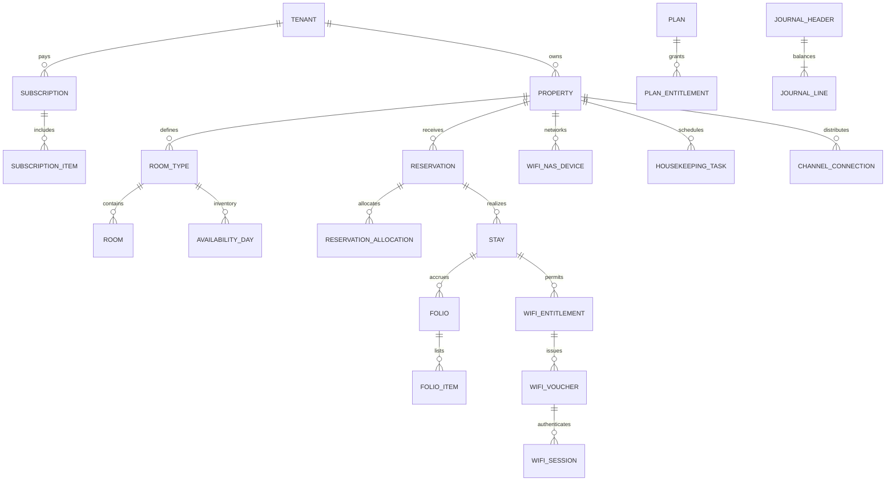

# HospitalityOS — Multi-Tenant Hotel Operations SaaS

> **Comprehensive Product, Architecture, Security, Integration, Billing, and Delivery Specification**  
> **Document:** `spec.md`  
> **Version:** 1.0 — Architecture baseline / proposed implementation  
> **Prepared:** 25 October 2026  
> **Status:** Draft for engineering and commercial review; **not** an assertion that any feature has been built or any third-party integration has been approved.  
> **Primary market:** Nigeria, designed for expansion to other jurisdictions.  
> **Primary stack:** Laravel 13, PHP 8.3+, Vue 3, TypeScript, PostgreSQL, Redis, WatermelonDB on the web, FreeRADIUS, MikroTik, Docker.

---

## How to read this specification

- **MUST** = required for production acceptance, security, data correctness, or the defined scope.
- **SHOULD** = strongly recommended; an alternative requires an explicit architecture decision record (ADR).
- **MAY** = optional, later phase, or customer-specific.
- **Decision** = agreed technical direction from product discovery.
- **Recommendation** = proposed design to validate in implementation.
- **Open decision** = unresolved product, commercial, legal, or integration question.
- Prices, service-level targets, performance budgets, and schedules in this file are **proposals**, not guaranteed offers or measured results.
- Regulatory and vendor-dependent behavior must be rechecked before a production launch, using vendor contracts, applicable local rules, and professional advice.

## Contents

1. [Executive summary](#1-executive-summary)
2. [Objectives, audiences, and product boundaries](#2-objectives-audiences-and-product-boundaries)
3. [Functional requirements by domain](#3-functional-requirements-by-domain)
4. [SaaS plans, entitlements, add-ons, and billing](#4-saas-plans-entitlements-add-ons-and-billing)
5. [System architecture and service boundaries](#5-system-architecture-and-service-boundaries)
6. [Technology stack and engineering standards](#6-technology-stack-and-engineering-standards)
7. [Multi-tenancy and authorization](#7-multi-tenancy-and-authorization)
8. [Reservation, stay, inventory, and financial invariants](#8-reservation-stay-inventory-and-financial-invariants)
9. [Offline-first Vue PWA and WatermelonDB](#9-offline-first-vue-pwa-and-watermelondb)
10. [Guest Wi-Fi, FreeRADIUS, and MikroTik](#10-guest-wi-fi-freeradius-and-mikrotik)
11. [External integrations and local edge agents](#11-external-integrations-and-local-edge-agents)
12. [APIs, events, sync, and interoperability](#12-apis-events-sync-and-interoperability)
13. [Data model and database strategy](#13-data-model-and-database-strategy)
14. [Security, privacy, auditability, and legal considerations](#14-security-privacy-auditability-and-legal-considerations)
15. [Local Docker and deployment architecture](#15-local-docker-and-deployment-architecture)
16. [Reliability, monitoring, backup, and disaster recovery](#16-reliability-monitoring-backup-and-disaster-recovery)
17. [Testing and acceptance criteria](#17-testing-and-acceptance-criteria)
18. [Implementation phases, staffing, and release gates](#18-implementation-phases-staffing-and-release-gates)
19. [Risks, recommendations, and trade-offs](#19-risks-recommendations-and-trade-offs)
20. [Open decisions and architectural decision records](#20-open-decisions-and-architectural-decision-records)
21. [Implementation backlog and definition of done](#21-implementation-backlog-and-definition-of-done)
22. [References and verification notes](#22-references-and-verification-notes)

---

## 1. Executive summary

### 1.1 Product concept

Build a cloud-managed, multi-tenant **Hotel Property Management System (PMS) and Hospitality Operations SaaS**. One platform serves independent guesthouses, hotels, resorts, serviced apartments, and multi-property groups. Capabilities are unlocked through commercial plans, purchasable modules, entitlement limits, and usage-based services.

Core functional areas:

1. Reservations, distribution, room inventory, rates, front desk, and guest stays.
2. Hotel folios, payments, receivables, tax, immutable accounting, night audit, reconciliation.
3. Housekeeping, maintenance, shifts, cash, expenses, procurement, restaurant/bar POS, events.
4. Staff roles, security, guest records, communication, guest portal, loyalty, reporting.
5. Door-lock integrations, channel management, accounting exports, hotel-local device bridge.
6. **Guest Wi-Fi Management** with FreeRADIUS, MikroTik as NAS, vouchers, speed and quota policy, RADIUS accounting, CoA/Disconnect, stay-triggered provisioning, and optional local offline service.
7. **Offline-first PWA** using WatermelonDB with its web LokiJS/IndexedDB persistence adapter and server-defined synchronization rules.
8. **SaaS commercial control plane** with tenant subscriptions, tier plans, add-ons, metering, invoices, and entitlements.

### 1.2 Foundational decisions

| Area | Decision | Rationale |
|---|---|---|
| Backend | Laravel 13 / PHP 8.3+ | Mature framework, domain orchestration, APIs, queues, policies |
| Frontend | Vue 3 + TypeScript + Pinia | Typed component-driven multi-portal experience |
| Offline web DB | WatermelonDB with web LokiJS/IndexedDB adapter | Reactive local data and explicit sync contract; validate package compatibility early |
| Primary persistence | PostgreSQL | Strong relational invariants and transactional consistency |
| Cache/queue | Redis + Laravel Horizon | Background work, bounded retry, operational visibility |
| Local development | PostgreSQL and Redis in Docker | Reproducible testing; optionally run API/workers/FreeRADIUS in Docker |
| Core deployment | **Modular monolith first** | Lower distributed-transaction and operational complexity |
| Integrations | Dedicated asynchronous worker processes/adapters | Failure isolation and back-pressure |
| Wi-Fi AAA | FreeRADIUS + MikroTik RouterOS | Protocol-native NAS authentication/accounting and dynamic authorization |
| Edge mode | Optional hotel-local FreeRADIUS, persistent policy store, agent | Authentication survives WAN failure if hotel LAN and power remain available |
| Monetization | Subscription tier + add-ons + usage + setup charges | Fits differing hotel sizes and optional modules |
| Accounting | Append-only ledger with compensating corrections | Auditability; no destructive editing of posted financial records |
| Service communication | Domain events, transactional outbox, idempotent consumers | Reliable asynchronous workflows without premature microservice extraction |

### 1.3 Architecture principle

> **A product module is a commercial and business capability; a microservice is a runtime/deployment boundary. These are not automatically the same thing.**

Start with a Laravel 13 PMS application organized into enforceable bounded contexts. Run integration workers independently where useful. Deploy **FreeRADIUS and the hardware edge** as separate systems because they have distinct protocol, security, latency, and availability requirements. Extract other independent services only when team ownership, scaling, isolation, or reliability benefits outweigh complexity.

### 1.4 Primary non-negotiables

- No confirmed overselling from concurrent *direct* reservations within the authoritative inventory system. OTA synchronization is ultimately asynchronous and must have contingency management.
- No financial posting without a balanced, traceable ledger operation.
- No successful payment inferred solely from a browser callback or an unverified webhook.
- No cross-tenant data reads or writes, including search, queues, analytics, exports, file storage, and local edge traffic.
- No claim of confirmed hotel availability, payment, Wi-Fi policy, room lock revocation, or OTA reconciliation until the authoritative system acknowledges it.
- No stored raw NIN/passport/license images in offline browsers by default.
- No blanket promise that hotels can finalize every workflow offline.
- No direct browser-to-MikroTik, browser-to-RADIUS, or browser-to-RFID-encoder administrative access.

---

## 2. Objectives, audiences, and product boundaries

### 2.1 Target customers

- Small guesthouses and independent hotels (e.g., 5–25 rooms).
- Growing hotels (e.g., 26–75 rooms).
- Larger hotels, boutique resorts, and conferences (e.g., 76–250 rooms).
- Hotel chains, operators, and group finance departments with multiple properties.
- Event venues with or without accommodation, subject to the event module.

### 2.2 Personas

| Persona | Jobs to be done | Typical scope |
|---|---|---|
| SaaS platform admin | Plans, invoices, tenants, support controls, global integration health | SaaS control plane; privileged and audited |
| Tenant/group owner | Company setup, multi-property reports, subscription, oversight | Assigned tenant(s) and properties |
| Property manager | Occupancy, pricing, staff, operations, exceptions | Assigned property |
| Receptionist | Search rooms, reservations, walk-ins, check-in/out, folios | Front desk and limited guest records |
| Accountant | Tax, revenue, ledger, receivables, cash reconciliation, exports | Financial permissions |
| Housekeeper | Room status, tasks, exceptions, limited guest details | Room operations only |
| Maintenance staff | Work orders, equipment, preventive maintenance | Assigned property |
| POS cashier | Restaurant/bar sales, tenders, room-charge requests | POS and assigned shift |
| Security personnel | Approved incident and access logs | Least privilege |
| Network technician | NAS settings, voucher health, Wi-Fi diagnostic logs | Wi-Fi administration; no guest finance rights |
| Guest | Own booking, online check-in, receipts, service requests, Wi-Fi | Self-service tenant/property-scoped identity |
| Corporate client | Authorized bookings, terms, account statements | Contract-limited company access |

### 2.3 Business goals

- Reduce manual front-desk errors and operational paper processes.
- Improve room utilization, direct booking conversion, revenue reporting, reconciliation, and owner visibility.
- Operate safely with intermittent connectivity and local power challenges.
- Provide a modular SaaS with predictable core pricing and clear third-party passthrough costs.
- Enable additional hotel revenue via POS, events, Wi-Fi upgrades, and corporate services.
- Support multiple properties and regions with explicit tax/currency/timezone settings.

### 2.4 Product success metrics (proposed)

| Metric | Initial target / measurement |
|---|---|
| Direct reservation correctness | Zero confirmed overlaps from tested core concurrency paths |
| Financial posting | 100% balanced ledger transactions by database-enforced validation |
| Tenant isolation | Zero cross-tenant findings in access-control security tests |
| Front desk task completion | Instrument search-to-book, check-in, checkout median times |
| Channel sync reliability | Lag, retries, last acknowledgment, and discrepancy count visible per channel |
| Offline operation | All designated offline-safe commands eventually resolve or visibly fail without silent loss |
| Wi-Fi AAA | Authentication p95, accounting ingestion lag, disconnect delivery outcomes measured |
| SaaS billing | Invoice/payment match rate and entitlement consistency tracked |
| Adoption | Activated properties, paid add-on attachment, retained subscribed rooms |

Targets must be established through pilot telemetry rather than treated as contractual SLAs today.

### 2.5 Explicit non-goals at initial launch

- A global travel distribution marketplace or replacement for Booking.com/Expedia.
- Fully offline guaranteed room allocation across independent external booking channels.
- A payment processor, banking service, or wallet holding hotel client funds.
- Writing a RADIUS protocol server in PHP.
- Guaranteed remote deactivation of every offline RFID key card, regardless of hardware design.
- Delivering every integration and module at MVP launch.
- Automatic legal compliance without tenant processes, contracts, and counsel review.

---

## 3. Functional requirements by domain

Each requirement is tagged `FR-...`; *P0 = core commercial launch*, *P1 = Nigeria-ready operations*, *P2 = integration/expansion*, *P3 = later optimization*. Priority is a sequencing recommendation, not a deletion of scope.

### 3.1 Reservations, room inventory, pricing, and distribution

| ID | Priority | Requirement |
|---|---|---|
| FR-RES-001 | P0 | Accept direct web reservations, front-desk walk-ins, phone bookings, group bookings, and corporate reservations; record source/channel. |
| FR-RES-002 | P0 | Represent hotel, building/floor, room type, physical room, status, occupancy capacity, amenities, and out-of-order periods. |
| FR-RES-003 | P0 | Search available room types over arrival/departure intervals with price quote and policy; display tax, fees, inclusions, cancellation rules. |
| FR-RES-004 | P0 | Support configurable rate plans, base/seasonal/weekend rates, length-of-stay restrictions, blackout dates, promotions, manual manager-approved overrides. |
| FR-RES-005 | P0 | Support reservation `hold`, `confirmed`, `modified`, `cancelled`, `no_show`, `checked_in`, `checked_out` workflows with transition audit. |
| FR-RES-006 | P0 | Prevent double-confirmation inside the authoritative room inventory service with transactional reservation/availability enforcement. |
| FR-RES-007 | P0 | Generate a booking reference, event history, invoice/receipt links, and optional arrival reminder. |
| FR-RES-008 | P1 | Support deposit rules, cancellation penalties, partial cancellations, upgrades, room swaps, early arrival, late checkout and extensions. |
| FR-RES-009 | P1 | Group booking blocks, rooming lists, corporate contracts, negotiated rates and consolidated folios. |
| FR-RES-010 | P2 | OTA/channel inventory push, booking imports, amendments/cancellations, channel mapping, discrepancy resolution. |

**Acceptance rules:** Night boundaries are calculated using each property's timezone and declared check-in/check-out policy. Define departure date as the **exclusive** end of the occupied-night interval. Distinguish `room type inventory` from `specific assigned physical room`. Expired unpaid holds release atomically; external channels never read transient uncommitted availability.

### 3.2 Front desk, guest identity, and stay lifecycle

| ID | Priority | Requirement |
|---|---|---|
| FR-FD-001 | P0 | Guest profiles, deduplication candidates, contact details, communication preferences, consent records. |
| FR-FD-002 | P0 | Check-in only with a valid reservation or approved walk-in; require an available assignable room and consistent stay dates. |
| FR-FD-003 | P0 | Check-out with review of folio balance, unsettled items, deposit/refund decisions, room status update, and receipt. |
| FR-FD-004 | P1 | ID document capture: NIN/passport/driver's license metadata and, when necessary, secured media capture; configurable retention and access. |
| FR-FD-005 | P1 | Early check-in, late checkout, extensions, stay transfer, additional occupants, incident notes, guest requests. |
| FR-FD-006 | P1 | On check-in/out publish lifecycle events to Wi-Fi and lock integration subscribers. |
| FR-FD-007 | P2 | Corporate guest allocation, repeat-guest preferences, loyalty history, online self check-in with staff approval where required. |

**Advice:** Never use NIN as an ordinary search token, public reservation reference, voucher username, or document storage path. Prefer verification tokens and masked identifiers to unrestricted ID copies. Requirement to collect particular identity fields must be validated against law and hotel operational necessity.

### 3.3 Folios, cashiering, tax, guest payments, and night audit

| ID | Priority | Requirement |
|---|---|---|
| FR-FIN-001 | P0 | Folios with line-item charges, credits, transfers, deposits, receipts, split payments, and settlement status. |
| FR-FIN-002 | P0 | Append-only double-entry journal for posted financial activity; reversals and adjustment entries only. |
| FR-FIN-003 | P0 | Cash/card/transfer/POS payment recording with verified status and correct ownership of funds. |
| FR-FIN-004 | P0 | Tax calculator using versioned configurable tax codes and jurisdiction-specific applicability; default Nigerian standard VAT rule where legally applicable. |
| FR-FIN-005 | P0 | Close out a business date with night-audit checks, room-night postings, exception review, and immutable audit run record. |
| FR-FIN-006 | P1 | Paystack and Flutterwave payments, webhooks, DVA/virtual account settlement, refunds, deposit capture/release, reconciliation. |
| FR-FIN-007 | P1 | Split bills by guest, room, company, department; allow room charges from POS after authorization. |
| FR-FIN-008 | P1 | Corporate credit ledger, statements, due dates, collections, and credit limits. |
| FR-FIN-009 | P1 | Register shifts, cashier opening/closing float, tender counts, discrepancies, cash drop and approvals. |
| FR-FIN-010 | P2 | Tax reports, accrual/deferral policies, general ledger export to QuickBooks/Zoho Books/Sage as supported. |

**Advice:** Maintain separate legal ledgers for **hotel guest transactions** and **the SaaS company's own subscriptions**. Never assume that a single Paystack/Flutterwave merchant account should receive all tenants' hotel revenues. The settlement model requires explicit payment onboarding/merchant ownership decisions.

### 3.4 Housekeeping, maintenance, utilities, and expenses

| ID | Priority | Requirement |
|---|---|---|
| FR-OPS-001 | P0 | Room status board: occupied/vacant versus clean/dirty/inspected/out-of-order modeled on separate axes. |
| FR-OPS-002 | P0 | Housekeeping task assignment, progress, timestamps, inspector approval, and housekeeping notes. |
| FR-OPS-003 | P1 | Maintenance requests, urgency, asset/room assignment, SLA, photos, vendor costs, resolution approval. |
| FR-OPS-004 | P1 | Expense categories, approval routing, attachments, recurring and nonrecurring costs. |
| FR-OPS-005 | P1 | Generator diesel purchases, runtime/hours, fuel stock, power sources, utility meter readings, variance reporting. |
| FR-OPS-006 | P1 | Employee shifts, cash handovers, operational checklists, incident logs. |
| FR-OPS-007 | P2 | Preventive maintenance, asset histories, stock reorder links, mobile task assignment. |

**Advice:** A room that is `vacant` is not necessarily `sellable`; combine inventory allocation, maintenance blocks, cleanliness policy, and management overrides before assignment.

### 3.5 POS, inventory, procurement, and events

| ID | Priority | Requirement |
|---|---|---|
| FR-POS-001 | P2 | Restaurant/bar menus, price lists, discounts, bill splitting, tenders, shift-level settlement. |
| FR-POS-002 | P2 | Verified room-charge posting tied to an active stay, authorized amount, and idempotency key. |
| FR-POS-003 | P2 | Stock items by location/unit, recipes/BOM where relevant, purchase orders, receipts, wastage, adjustments. |
| FR-POS-004 | P2 | Track linen and amenity consumption independently of food/beverage inventory where workflows differ. |
| FR-EVT-001 | P2 | Event/conference space inventory, time-slot availability, quotes, deposits, catering/resource allocation and contracts. |
| FR-EVT-002 | P2 | Event folios/invoices; optional consolidated corporate billing. |

**Advice:** A consumable item should not be decremented twice because a POS request is retried. Inventory valuation and COGS rules require an explicit accounting policy.

### 3.6 Reporting, communication, and guest experience

| ID | Priority | Requirement |
|---|---|---|
| FR-REP-001 | P0 | Occupancy, room revenue, ADR, RevPAR, arrivals/departures, cancellation/no-show trends, source mix. |
| FR-REP-002 | P0 | Daily night-audit report, shifts/cash reconciliation, adjustment and exception reports. |
| FR-REP-003 | P1 | Staff performance with context (volume, SLA, quality), property comparisons, diesel/utility cost trends. |
| FR-REP-004 | P1 | Exports to CSV/XLSX/PDF with permission checks and redaction; asynchronous for large reports. |
| FR-COM-001 | P1 | Booking confirmation, reminder, cancellation, checkout and guest request SMS/WhatsApp templates. |
| FR-COM-002 | P1 | Delivery status, opt-in/opt-out, consent/legitimate-basis tracking, retry caps, quiet hours, cost metering. |
| FR-GUEST-001 | P2 | Self-service portal: booking details, online check-in request, receipts, service requests, Wi-Fi vouchers. |
| FR-GUEST-002 | P2 | Loyalty/CRM, repeat-stay history, targeted promotions subject to marketing consent and rules. |

**Metric definitions:**
- `occupancy % = occupied room-nights / available sellable room-nights × 100`; clearly define exclusion of out-of-order inventory.
- `ADR = eligible room revenue / rooms sold`.
- `RevPAR = eligible room revenue / available rooms`, equivalently ADR × occupancy on the same population/basis.
- Finance chooses consistent treatment of taxes, comps, day-use, refunds, and currency conversion.

### 3.7 Staff identity, permissions, and audit

| ID | Priority | Requirement |
|---|---|---|
| FR-IAM-001 | P0 | Role- and property-scoped permissions for receptionist, manager, accountant, housekeeper, owner and custom roles. |
| FR-IAM-002 | P0 | MFA for privileged users (owners, managers, platform administrators), sessions, device revocation and secure password reset. |
| FR-IAM-003 | P0 | Full business-level audit logging for material reads/changes, privilege changes, identity access, financial activity, Wi-Fi revocations and lock actions. |
| FR-IAM-004 | P1 | Manager approval for rate overrides, refunds, write-offs, cash discrepancies, privileged exports. |
| FR-IAM-005 | P2 | Enterprise SSO/SCIM if justified; separation of duties and support impersonation with explicit consent, time bound, and logging. |

### 3.8 Door locks and physical security

| ID | Priority | Requirement |
|---|---|---|
| FR-LOCK-001 | P2 | Vendor-neutral credential issue, duplicate/replacement, staff/master card types, extension, revocation requests, event history. |
| FR-LOCK-002 | P2 | Douwin-compatible RFID encoder bridge only where validated against exact encoder, lock, SDK/protocol, OS, and licensing. |
| FR-LOCK-003 | P2 | Cloud/vendor adapter layer for TTLock, Salto, and additional qualified vendors. |
| FR-LOCK-004 | P2 | Correlate credential issuance with active stay and approved room; log operator, terminal and device results. |
| FR-LOCK-005 | P2 | Support lock audit trail retrieval when the vendor exposes it; retain tamper-resistant security events. |

**Safety boundary:** For offline cards/locks, a database `revoked` flag is not proof that a physical lock has invalidated a previously encoded card. UI MUST show requested/applied/verified status separately.

### 3.9 Channel management and distribution

| ID | Priority | Requirement |
|---|---|---|
| FR-CH-001 | P2 | Normalize rate plans, room types, taxes, currency, occupancy policies and channel identifiers. |
| FR-CH-002 | P2 | Push rate/inventory changes with acknowledgments; pull/import reservations and modifications idempotently. |
| FR-CH-003 | P2 | Dead-letter queue and alert for failed sync, stale channels, mapping errors and potential overbookings. |
| FR-CH-004 | P2 | Support Booking.com, Expedia, Hotels.ng, Travelbeta **only after technical/contractual access is verified**; adapter capability status per provider. |
| FR-CH-005 | P2 | Manual reconciliation screen and override workflow when an OTA is offline or out of sync. |

**Current external constraint:** Booking.com's connectivity portal states that integrations with **new connectivity providers are paused** and individual properties should use channel managers. Plan for an established connectivity partner or explicitly budget for partnership onboarding risk; do not advertise a direct Booking.com integration as complete before approval.

## 4. SaaS plans, entitlements, add-ons, and billing

### 4.1 Billing principles

1. Every tenant subscribes to one **base plan** (unless an enterprise contract specifies otherwise).
2. Each plan grants **capabilities** and **limits**; limits may apply at tenant, hotel group, property, room, NAS, or integration level.
3. Modules such as POS, channel manager, smart locks, events, CRM, advanced reports, and guest Wi-Fi are optional add-ons if not included in a higher tier.
4. A module may expose **subfeatures** (e.g., `wifi.vouchers`, `wifi.local_edge`, `wifi.analytics`).
5. Track metered service use: e.g., SMS messages, WhatsApp provider charges, premium integration throughput only if clearly disclosed, optional managed edge support.
6. One-time charge items include migrations, hardware setup, onboarding, training, and custom integrations.
7. User logins SHOULD NOT be the main pricing unit: per-seat pricing encourages shared staff accounts and degrades auditability. Prefer room count/property scope and clear fair-use controls.
8. Security, backup, financial correctness, tenant isolation, fundamental audit trails, and minimum export/record retention cannot be disabled via pricing tiers.

### 4.2 Illustrative initial tier catalog (not approved prices)

| Tier | Illustrative monthly base | Guideline capacity | Included baseline |
|---|---:|---|---|
| Starter | ₦39,000 | 1 property, up to 15 rooms | Core reservations, front desk, folios, receipts, basic housekeeping and reporting, security |
| Growth | ₦99,000 | 1 property, up to 50 rooms | Starter + advanced operations, expenses, shifts, reconciliation tools, supported offline workflows |
| Professional | ₦199,000 | 1 property, up to 100 rooms | Growth + richer reporting, inventory, corporate/CRM functions and integration capabilities |
| Enterprise | Contract | Multiple properties | Negotiated property/room limits, consolidated reporting, support and integration package |

Example optional catalog, subject to research and unit economics: POS ₦25k/property/month; channel manager ₦35k/property/month plus provider costs; smart locks ₦20k/property/month plus devices/implementation; CRM ₦15k/property/month; events ₦15k/property/month; Wi-Fi software **pricing to be validated** per property; hotel-local managed Wi-Fi edge quoted separately; SMS/WhatsApp metered. Do not automatically include real hardware, carrier charges, third-party platform access, or staff installation in a software line item.

**Annual discount recommendation:** experiment with 10–15% on recurring software only, not pass-through SMS, one-time projects, or hardware. Store immutable agreement snapshots for all negotiated rates.

### 4.3 Entitlement model

A feature is resolved in this order (most restrictive security constraints always win):

1. Global safety/compliance policy and organization eligibility.
2. Active tenant status and subscription/billing grace state.
3. Base plan entitlement.
4. Active paid add-on entitlement.
5. Explicit, signed, time-limited commercial override or enterprise contract.
6. Applicable tenant/property quantitative limits.
7. User-specific role/policy permission.
8. Operational prerequisites (configured merchant, registered NAS, certified lock, valid venue setup).

**Rule:** Feature authorization is checked by the Laravel backend at command boundaries. Vue may hide controls or offer upgrades but is never the authority. An add-on purchase does not bypass RBAC, tenant boundaries, or device health requirements.

Suggested namespaced entitlement keys:

```text
pms.reservations, pms.group_booking, rates.promotions,
finance.folios, finance.advanced_reports,
operations.housekeeping_advanced, operations.expenses,
pos.sales, inventory.procurement, events.bookings,
channels.sync, channels.provider.booking_com,
locks.issue, locks.offline_encoder, locks.cloud_vendor,
wifi.vouchers, wifi.radius, wifi.coa, wifi.tier_upsell,
wifi.analytics, wifi.local_edge,
crm.loyalty, guest.portal, reporting.portfolio

limits.rooms.max
limits.properties.max
limits.wifi.nas.max
limits.wifi.concurrent_sessions.max
limits.channels.connections.max
limits.api.daily_calls
```

Use an explicit entitlement value type: `boolean`, `integer_limit`, `decimal_limit`, `enum`, or `scope`. Quantities must include units, scope, and a definition of utilization. Avoid hardcoding plans in frontend/router components or scattering plan-name comparisons in domain services.

### 4.4 Subscription lifecycle

State machine recommendation:

```text
trialing -> active -> past_due -> grace -> restricted -> cancelled
             |          |           |             |
             +-> paused |           +-> active    +-> reactivated
             +-> cancelling_at_period_end -> cancelled
```

- **Trialing:** configured capacity and time limit; visible expiration date.
- **Active:** entitlements in force and invoices compliant.
- **Past due:** retries/manual collection; preserve service temporarily.
- **Grace:** explicit number of days, reminder notices, policy configurable by agreement.
- **Restricted:** stop new premium/money-creating actions according to policy; preserve exports, necessary record access, and safe checkout processes. Never strand guests or invalidate physical safety controls without an agreed runbook.
- **Cancelled:** revoke new feature use; data export and retention/deletion governed by contractual and legal policies.
- **Plan upgrade:** immediately grant after accepted billing authorization; prorate the remainder of the cycle.
- **Plan downgrade:** generally at renewal; validate count/active resource violations in advance, grandfather or freeze gracefully.
- **Add-on cancellation:** at renewal unless separately agreed; release credentials/integrations safely.
- **Refund/chargeback:** reconcile with invoice and adjustment workflow; do not delete original records.

### 4.5 Invoice/usage examples

```text
Subscription invoice for Property X
Growth base plan                    NGN  99,000
POS add-on                         NGN  25,000
Channel manager add-on             NGN  35,000
SMS metered usage                  NGN   4,000
Subtotal                           NGN 163,000
Applicable SaaS taxes              computed by tax engine
Due                               subtotal + tax - credit
```

A hotel guest folio is a separate business transaction: guest Wi-Fi upsell revenues belong to the **hotel's merchant/ledger** unless a separately negotiated and legally reviewed marketplace/agency model is used. The SaaS invoice pays for access to the Wi-Fi management functionality and managed services.

### 4.6 SaaS billing domain data and operations

Required tables: `plans`, `plan_versions`, `plan_prices`, `modules`, `features`, `plan_entitlements`, `addons`, `addon_prices`, `subscriptions`, `subscription_items`, `subscription_history`, `tenant_entitlement_overrides`, `usage_events`, `usage_aggregates`, `billing_invoices`, `billing_invoice_lines`, `billing_payments`, `payment_provider_events`, `credits`, `coupons`, `tax_rule_versions`.

Operations:

- `quoteSubscriptionChange()` computes proration, taxes, credits and effective date.
- `activateSubscription()` requires contract and supported billing arrangement.
- `resolveEntitlements(tenant, property, user)` caches results with version invalidation.
- `recordUsage(eventId, feature, quantity, unit, occurredAt, scope)` must be idempotent.
- `generateInvoice(billingPeriod)` must be retry-safe and freeze itemized prices.
- `reconcilePayment(providerReference)` verifies amount, currency, merchant, state, and invoice ownership.
- `applyRestrictionPolicy()` should be feature-sensitive and safety-aware.

Recommended API examples:

```http
GET  /api/v1/saas/catalog
GET  /api/v1/saas/subscription
POST /api/v1/saas/subscription/changes/quote
POST /api/v1/saas/subscription/changes
GET  /api/v1/saas/invoices
GET  /api/v1/me/entitlements
GET  /api/v1/saas/usage
```

All mutation endpoints require permissions and audit context. Billing and usage event ingestion must reject duplicate event IDs and out-of-scope tenants.

### 4.7 Commercial advice

- Pilot prices with real Nigerian properties of varied sizes; research willingness to pay and total cost of ownership before public launch.
- Show add-on prerequisites, per-property limits, third-party charges, setup fees, tax treatment and fair-use constraints **before purchase**.
- Permit modules on lower tiers where technically feasible; avoid artificial plan upgrades to use one feature.
- Sell **managed edge connectivity** as a support/availability service with transparent equipment responsibility, rather than promising free unlimited onsite support.
- Offer migration/onboarding assistance as a paid, optional service with a standardized checklist.
- Define support tiers and response targets independently of feature entitlements.

---

## 5. System architecture and service boundaries

### 5.1 Logical topology



The diagram shows **logical ownership**, not an instruction to create dozens of separate deployments. `PMS`, `IAM`, and `SAAS` may initially run in a single Laravel application with clean module boundaries; integration workers, FreeRADIUS, and edge runtimes can be independently deployed.

### 5.2 Deployment units (recommended baseline)

| Unit | Initial deployment | Owns | Why |
|---|---|---|---|
| `web-frontend` | Static web deployment + PWA service worker | Staff/guest UI assets | Independent build/versioning |
| `api-core` | Laravel application | Domain commands, REST, auth, entitlement checks | Strong transaction boundary |
| `queue-workers` | Laravel worker containers | External I/O, event delivery, retries | Workload/back-pressure isolation |
| `scheduler` | One active Laravel scheduler process | Night audit triggers, recurring tasks | Prevent duplicate cron execution |
| `postgres` | Docker locally; HA-oriented deployment in production | Core OLTP database | Correctness |
| `redis` | Docker locally; monitored deployment in production | Queue/cache/realtime | Transient operational state |
| `radius-runtime` | Separate service/container, edge preferred for offline hotels | RADIUS auth, accounting and CoA | Protocol uptime, specialized configuration |
| `edge-agent` | Hotel-hosted signed daemon/container where hardware supports it | Policy sync, RFID adapter, NAS command delivery | Locality and WAN resilience |
| `reporting-worker` | Initially Laravel queue worker | Read models, exports, heavy reports | Avoid synchronous heavy queries |

### 5.3 Laravel bounded contexts and dependencies

```text
apps/
  api/                        # Laravel 13
    app/
      Domain/
        Platform/             # tenants, properties, subscription, catalog
        Identity/             # users, roles, sessions, MFA
        Reservations/         # inventory authority, rate plans, holds
        FrontDesk/            # stays, room assignment, guest lifecycle
        Guest/                # profiles, documents, requests
        Finance/              # folios, journal, tax, receipts, audit
        Operations/           # housekeeping, maintenance, shifts, expenses
        POS/                  # sales and room-charge orchestration
        Inventory/            # stock, purchasing
        Events/               # conference rooms/venues
        CRM/                  # loyalty, preferences
        WiFi/                 # plans, vouchers, entitlements, reports
        Integrations/         # provider interfaces and adapters
        Reporting/            # read models and analytics
      Application/            # use cases / commands / event subscribers
      Infrastructure/         # persistence, messaging, file store
      Http/                   # controllers, requests, auth middleware
      Support/                # shared IDs, money, clock, contracts
  staff-web/                  # Vue app
  guest-web/                  # Optional separate Vue entry/app
services/
  edge-agent/                 # signed, managed hotel-local agent
  radius-config/             # FreeRADIUS config and SQL fixtures
packages/
  contracts/                  # API schemas, generated clients, event definitions
  shared-ui/                  # Vue components and tokens (optional)
infra/
  compose/
  migrations/
  terraform/                  # If adopted later
```

**Enforce dependency rules:** Reservations cannot import Finance's internal repositories; communicate through application interfaces/domain contracts. No module directly updates another module's owned tables, even if they share PostgreSQL. Cross-module reporting uses read models or approved projections.

### 5.4 Event-driven strategy

- Perform authoritative write and enqueue the domain event in the **same PostgreSQL transaction** using a transactional outbox table.
- A worker publishes pending events; a consumer records `event_id` in an inbox/deduplication table before applying side effects.
- Deliveries are **at least once**, not exactly once. Consumers MUST be idempotent.
- Event names and schemas versioned, e.g. `reservation.confirmed.v1`, `stay.checked_in.v1`, `folio.charge_posted.v1`, `wifi.entitlement_revoked.v1`.
- Store correlation ID, causation ID, timestamp, tenant/property ID, aggregate ID/version, trace ID, schema version.
- Use retriable errors, exponential backoff with jitter, DLQ/replay UI, and bounded retries.
- Use a durable broker when cross-process load demands it; Redis/Horizon is adequate for initial asynchronous work but does not replace the outbox and deduplication invariants.

### 5.5 When to extract a microservice

Extract a bounded context only when **one or more** of these are supported by metrics and operating constraints:

1. Independent scaling or latency targets materially differ from Laravel core.
2. Security/network segmentation requires separate deployable runtime (RADIUS qualifies).
3. Vendor-specific dependencies conflict with the main runtime (hardware bridge qualifies).
4. Team ownership and deploy cadence are demonstrably independent.
5. Failure isolation outweighs added distributed consistency, DevOps and observability costs.

Candidate later extracts: high-volume channel manager, messaging service, Wi-Fi control plane, analytics warehouse. Avoid distributing reservation inventory and its transaction authority early.

### 5.6 Consistency model

- **Strong consistency** within a reservation inventory allocation, a stay transition, financial ledger posting, and subscription purchase transaction.
- **Eventual consistency** for channels, notifications, analytics, hotel edge policy replication, and external payment status.
- **Compensation / saga** for cross-service workflows: e.g., booking confirmation → deposit collection → guest notification; retries and compensating actions are explicit.
- Webhook result and UI state are not transaction authorities until verified and persisted.

---

## 6. Technology stack and engineering standards

| Concern | Recommended technology / practice | Note |
|---|---|---|
| Backend | PHP 8.3+ / Laravel 13 | Check package compatibility before lockfile creation |
| Runtime | PHP-FPM or Laravel-supported application server | Establish benchmark and operational expertise |
| Frontend | Vue 3, TypeScript, Vite, Vue Router | Typed build, route-level RBAC hints |
| State | Pinia | Remote state distinct from local WatermelonDB models |
| Styling | Tailwind CSS + accessible Vue component library | Keyboard and screen reader validation |
| Primary DB | PostgreSQL 17 locally as reproducible baseline | Upgrade policy; extension approvals |
| Queue/cache | Redis 7 locally + Laravel Horizon | Different Redis logical uses and eviction policy |
| Offline DB | WatermelonDB + LokiJS/IndexedDB | Requires Vue integration and browser resilience PoC |
| PWA | Service worker + manifest + Workbox | Offline assets and controlled upgrades |
| Identity | Sanctum for first-party sessions, policies/gates, MFA | Use OAuth/OIDC if federation required |
| Auth web | HttpOnly Secure SameSite cookies, CSRF defenses | Token lifecycle managed on server |
| Live updates | Laravel Reverb (if suited) | Subscriptions filtered by tenant/property |
| Objects | S3-compatible private encrypted storage | Presigned, short-lived downloads |
| Events | Transactional outbox/inbox | Versioned schemas |
| Telemetry | OpenTelemetry-compatible traces, logs, metrics | PII filtering |
| Tests | PHPUnit/Pest, Vitest, Playwright, Docker contract tests | CI gates |
| Delivery | Docker Compose locally, CI/CD, managed secrets | Separate environments and immutable images |

**Compatibility checkpoint:** Laravel 13's official release notes say minimum PHP 8.3. WatermelonDB official web docs show the LokiJS adapter with IndexedDB persistence; they do **not** imply a native browser SQLite store. Research maintenance status, peer dependencies, Vue reactive adapter, multi-tab behavior and browser support at spike time. If a critical compatibility issue is proven, raise an ADR before changing the agreed WatermelonDB choice.

### 6.1 Coding conventions

- PHP: strict typing, PSR conventions, Rector/PHPStan or Larastan, Laravel Pint, no business logic inside controllers/jobs.
- TypeScript: strict compilation, no broad `any`, schema validation at network boundaries, domain DTOs generated from OpenAPI where practical.
- Use structured `Money {minor_amount, currency}` or decimal domain type; never float for monetary calculations. NGN kobo stored as integer minor units.
- Timestamp storage in UTC; interpret property-local business dates using IANA timezone (default may be `Africa/Lagos`, not hardcoded globally).
- Use ULIDs/UUIDs for public identifiers, independent tenant ID and stable property ID. Do not assume numeric IDs are unguessable.
- Every mutation with external side effects uses `Idempotency-Key` and/or durable deduplication.
- Database constraints and transactions enforce correctness; frontend validations are UX only.
- Feature flags control progressive releases; commercial entitlements control access; keep these distinct.

---

## 7. Multi-tenancy and authorization

### 7.1 Organization hierarchy

```text
SaaS Platform
  └── Tenant / Hotel operator (billing account)
        ├── Property A
        │     ├── Rooms, rates, shifts, staff assignments, NAS devices
        │     └── Reservations, folios, vouchers, reports
        ├── Property B
        └── Group-level consolidated reporting and corporate accounts
```

- `tenant` is the billing and top-level data ownership boundary.
- `property` is the operational boundary for hotels, taxes, business day, rooms, staff assignment, and integration resources.
- Some organization-level guest/corporate records may be shared across properties **only under explicit tenant policy and consent/legal basis**.
- Users may belong to multiple tenants and properties with different roles. Switching active tenant/property requires server-side authorization, not just a header.

### 7.2 Persistence strategy

**Initial recommendation:** Single PostgreSQL OLTP cluster, shared schema with `tenant_id` on all tenant-owned tables and `property_id` for property-specific tables; strong app scoping with Postgres RLS considered/implemented as defense in depth for higher-risk tables. Use DB constraints on composite identifiers where possible; queries, background jobs and exports must explicitly bind tenant context. For compliance-sensitive enterprise contracts, plan an optional tenant-dedicated database later.

Rules:

- Global control-plane data and tenant-owned operational records should use separate schemas or tightly controlled repositories as needed.
- Unique constraints must include tenant/property scope where the domain is not globally unique.
- PostgreSQL foreign keys should enforce ownership where feasible (e.g. composite `(tenant_id, property_id, id)` patterns).
- Jobs, scheduler tasks, cache keys, object keys, WebSocket channels, search indices and analytics partitions require tenant-scoped contexts.
- Signed S3 object access and export URLs must expire and be checked against permission at issuance.
- One tenant's requested deletion/export MUST NOT affect another tenant's shared records.

### 7.3 Permission model

Permission = **role capability** AND **property membership** AND **resource relationship** AND **effective SaaS entitlement** AND **optional approval policy**.

Sample matrix (`R`=read, `W`=create/update, `A`=approve, `-`=denied by default):

| Operation | Reception | Manager | Accountant | Housekeeper | Owner | Network admin |
|---|---|---|---|---|---|---|
| Reservation / check-in | RW | RWA | R | Limited | R | - |
| Folio charge/refund | Limited W | A | RWA | - | R/A | - |
| Tax and ledger export | - | R | RWA | - | R | - |
| Room status/tasks | R | RWA | - | RW | R | - |
| Pricing override | - | A | - | - | A | - |
| Wi-Fi issue/disable | Limited W | RWA | R | - | R | RWA |
| NAS/CoA configuration | - | - | - | - | Oversight | RWA |
| Lock master/staff cards | - | Approval | - | - | Approval | - |
| Subscription management | - | - | Limited R | - | RWA | - |

Implement fine-grained permissions (`folios.refund.approve`, `wifi.nas.configure`, `guest.identity.read_full`) rather than relying only on the table.

### 7.4 Support access

Platform customer support must not have unrestricted access to guest identity documents or guest financials. Support escalation requires a support case, customer approval (except lawful emergency), time-limited scope, break-glass reason, immutable audit record, and masking by default.

## 8. Reservation, stay, inventory, and financial invariants

### 8.1 Availability model

- The booking engine can sell a **room type** or a specific **physical room**, depending on property policy. A type-level booking may be assigned to a physical room at check-in.
- Use half-open date intervals `[arrival_date, departure_date)` for room nights; overlap occurs when `start_a < end_b AND start_b < end_a`.
- `physical_room_blocks` include sold/assigned stay, maintenance/out-of-order, and explicit admin block. Reservations also affect type-level sellable inventory before physical assignment.
- Implement room-type inventory through a **daily availability allocation table** (`availability_day`) with transactional row locks, or an equivalent serialized inventory authority. Date-range exclusion constraints are useful for assigned rooms but **not sufficient alone** to prevent overbooking at room-type level.
- For confirmed allocations, calculate capacity minus confirmed allocations, maintenance blocks, channel holds, and explicit inventory allotments **within one transaction**. Do not accept a quote as a guarantee before the transaction commits.
- Quote rates must include price version, taxes/levies, currency, policy, expiry and discount code validation. On payment, revalidate quote and availability, or reserve a bounded hold.
- Lock ordering is deterministic (property, room type, date) to reduce deadlocks. Retry retriable serialization/deadlock errors with bounded attempts.
- OTA inventories are asynchronous: export changes through channel workers, track provider acknowledgment and discrepancies, and provide mitigation (buffers, stop-sell rules, alerting) for transient divergence.

#### Booking transaction pseudocode

```text
BEGIN DB TRANSACTION
  authorize tenant/property and feature
  read validated quote and hold expiration
  SELECT target room-type/day rows FOR UPDATE (stable order)
  assert capacity >= requested units for each requested night
  insert reservation + inventory allocations with unique idempotency key
  update capacity/count projection and quote state
  insert reservation.confirmed.v1 into outbox
COMMIT
return authoritative reservation + status
```

For an assigned physical room, enforce a no-overlap invariant using PostgreSQL range types/exclusion constraints or an equivalently correct transaction boundary; include maintenance blocks in sellable status. A failed write must never leave a partially confirmed booking.

### 8.2 Reservation and stay state machines

```text
Reservation: draft -> held -> confirmed -> checked_in -> checked_out
                  \-> expired    \-> cancelled   \-> cancelled/no_show

Stay: pending_checkin -> in_house -> checkout_pending -> checked_out
                             \-> transferred / extended (audited transitions)
```

- A reservation and an in-house **stay** are distinct entities.
- A checked-in reservation may have multiple occupants, guest folios, and room changes over time.
- Check-in authoritatively emits `stay.checked_in`; Wi-Fi and card issuance workers subscribe to the event, but their failure must not silently roll back a completed hotel check-in. Show **pending provisioning** and allow authorized manual remediation.
- On checkout, revoke related entitlements, close eligible folio balances, adjust housekeeping state, and trigger integrations. Revocation is an eventually confirmed external action; log retries and unreached devices.
- Group/corporate booking blocks have expiry, deposit and release policy. Do not count tentative group interest as confirmed unless a block is formally held.

### 8.3 Night audit / business date

- Each property has a `business_date` distinct from current wall-clock date. Configure rollover window, e.g. 02:00 local time, but record actual event timestamps in UTC.
- Night audit checks missing room charges, occupied rooms without stays, folio discrepancies, unclosed shifts, pending deposits/refunds and maintenance blocks.
- It posts room revenue using a **unique key** `(property_id, business_date, stay_id, charge_type)` to prevent duplicate room-night posting.
- Audits may be rerun in **dry run**; finalized financial posting may only be corrected through adjustment/reversal, not deletion.
- Night audit can have `draft`, `running`, `exceptions`, `finalized`, and `reopened_by_approval` statuses. Reopening does not erase posting history.
- Store who approved exceptions, report snapshot, ledger entries created, and audit job version.

### 8.4 Folios and financial ledger

**Ledger structure:** `journal_headers` + `journal_lines` where each posted journal has balanced debits and credits per currency (cross-currency conversion represented explicitly). Store money in integer minor units with consistent currency. A database transaction must atomically insert journal, lines, folio movement, and outbox event.

Example room-charge posting (simplified):

```text
Guest charge of NGN 50,000, tax exclusive:
  Dr Accounts Receivable / Guest Folio   50,000 + applicable tax
  Cr Room Revenue                         50,000
  Cr Tax Payable                          applicable tax

Cash/bank settlement:
  Dr Verified Cash/Bank/Clearing
  Cr Accounts Receivable / Guest Folio
```

This is an illustrative accounting shape, **not** a chart-of-accounts or tax/legal opinion. Deposit liability, refunds, recognized revenue, fees, service charges, corporate credit, and commission handling require accounting sign-off. VAT treatment depends on taxable supplies and exemptions; local hospitality levies depend on jurisdiction and applicability.

Rules:

- No `UPDATE` or `DELETE` of posted journal lines from normal application paths; corrections are reversal plus new journal.
- Refund authorization independent of refund settlement; record attempted/settled/failed and processor reference.
- Require idempotent webhook processing, server-side provider verification, reconciliation against actual settlement and merchant account identity.
- Never store full card details; use provider-hosted payment collection/tokenization and minimize PCI scope.
- Split bills move economic responsibility with linked postings, not mutating historical amounts.
- Rooms POS charge must target a checked-in stay and pass spending policy; hold/retry idempotency to prevent duplicated charge.
- Record each tax version and the basis used on every invoice line, so later tax-rule changes do not rewrite history.

### 8.5 Cash, expenses, and utilities

- Cash shifts require opening float, tender movements, void/refund approvals, drops, closing count, variance reason.
- Expenses require payee, source receipt, currency, expense category, posting date, property and approval status.
- Diesel/generator: purchases in litres, inventory, dip readings, generator hours, consumption estimates, anomalies and cost-center tags.
- Expense entry made offline can be a **draft**; posted cash/ledger reconciliation remains online/authorized and idempotent.

### 8.6 Payments and gateway flows

1. Laravel creates internal `payment_intent` with `tenant/property`, associated folio or SaaS invoice, amount, currency, allowed provider, merchant account.
2. Provider checkout is initiated or DVA allocated where provider and merchant capabilities allow.
3. Provider webhook received over TLS, signature/authenticity checked, event ID deduplicated and stored **before** side effects.
4. Verify transaction status, currency, amount, merchant/account ownership, and payment intent; suspicious mismatches go to review.
5. Apply settlement to the correct ledger with a unique reconciliation key; notify relevant domains.
6. Execute daily reconciliation of expected provider settlements, bank statements/POS terminals, partial refunds and chargebacks.
7. Surface `pending`, `verified`, `settled`, `reversed`, `disputed`, and `failed` distinctly.

Paystack and Flutterwave adapters MUST implement provider-specific signing, callback verification, pagination, throttling, retries and API changes. For recurring **SaaS** billing, keep subscription calculation authoritative in our control plane: providers are collection methods, not the only source of contract/pricing logic.

---

## 9. Offline-first Vue PWA and WatermelonDB

### 9.1 Browser architecture

**Decision:** WatermelonDB is the selected client-side data model and sync engine; on the web, use its supported **LokiJS adapter persisted through IndexedDB**. It is inaccurate to assume WatermelonDB uses a native IndexedDB SQL driver or web SQLite by default.

```text
Vue components / Pinia UI state
        ↓
Composables / reactive WatermelonDB queries
        ↓
WatermelonDB models + LokiJS adapter
        ↓
IndexedDB persisted browser store
        ↕
Sync coordinator: pull / push / business command outbox
        ↕ HTTPS + authenticated API
Laravel sync + domain command endpoints
        ↓
PostgreSQL authoritative state + change feed
```

The PWA service worker handles cached static assets and selected safe GET content; it must not be mistaken for guaranteed background sync execution or persistence. Mobile browsers may suspend workers/tabs, evict data, limit storage, and restrict background tasks. Sync on foreground/resume/reconnection with explicit UI controls and retry strategies.

### 9.2 Offline data classification

| Data/action | Offline read | Offline edit | Sync policy |
|---|---|---|---|
| Assigned room lists / current housekeeping task snapshots | Yes, filtered | Yes | Merge/optimistic version with conflict resolution |
| Housekeeping checklists and notes | Yes | Yes | Locally queued; server validates transition |
| Maintenance tickets / non-sensitive photos | Selected | Draft allowed | Versioned update; deferred attachment upload |
| Operational expenses | Selected | Draft allowed | Server approves before ledger posting |
| Reservation search | Last-known snapshot only | No guaranteed confirmation | Online authoritative inventory |
| Reservation draft | Yes | Draft only | Quote/availability revalidated online |
| Check-in/out | Last-known state | Restricted/offline provisional workflow only if later explicitly designed | Server validates; pending never masquerades as complete |
| Folios, ledger, refunds | Limited non-sensitive snapshots | No final posting offline | Server authoritative |
| Guest ID images / NIN | No by default | No | Secure server upload only |
| Wi-Fi plans / voucher lists | Limited masked snapshot | No browser-side authoritative activation | Edge/cloud policy authority |
| Live RADIUS accounting | Last known with timestamp | No | Authoritative AAA/accounting service |
| Door-lock issuance | No browser direct access | Edge-agent-mediated, only under explicit local approved policy | Agent-signed result and audit |
| Channel inventory | Last known with freshness warning | No authoritative offline push | Reconcile after reconnect |
| SaaS subscription and entitlements | Signed/expiring snapshot for UX | No local purchase confirmation | Server authority; safe offline policy |

### 9.3 WatermelonDB sync contract

Use WatermelonDB's documented `synchronize({ pullChanges, pushChanges })` contract for selected replicable data. `pullChanges` takes `lastPulledAt`, schema version/migration and returns server-authoritative `{changes, timestamp}`. `pushChanges` is all-or-nothing for Watermelon change sets; the backend must validate tenant/property scope and abort on unresolved server-side changes since the client's cursor.

Recommended endpoints:

```http
POST /api/v1/sync/pull
POST /api/v1/sync/push
GET  /api/v1/sync/status
POST /api/v1/offline-commands/batch
GET  /api/v1/offline-commands/{id}
```

`POST /sync/pull` request:

```json
{
  "device_id": "device_01",
  "property_id": "prop_01",
  "last_pulled_at": null,
  "schema_version": 1,
  "migration": null,
  "collections": ["rooms_public", "housekeeping_tasks"]
}
```

Example response shape (simplified):

```json
{
  "changes": {
    "housekeeping_tasks": {
      "created": [{"id":"6An8RjT2dF4kL0pQ", "room_id":"room_01", "status":"assigned", "version":1}],
      "updated": [],
      "deleted": []
    }
  },
  "timestamp": 1790000000000
}
```

**Note:** Timestamps and IDs above are example payloads only. The production cursor MUST represent a consistent view. Prefer a committed change-log watermark rather than naive wall-clock timestamps when designing concurrent sync. An increasing sequence ID alone can be unsafe if sequence allocation order differs from transaction commit order; use commit-consistent cursor semantics, snapshot visibility, or a documented transactional change tracking approach.

Requirements:

- Whitelist sync collections/columns; never sync full financial/identity data to all devices.
- Filter server pulls by authenticated principal and authorized property; permission revocation must emit tombstones for previously accessible records.
- Durable tombstones must remain long enough for expected offline clients; beyond retention require secure rebootstrap.
- Support schema migrations and migration sync; maintain compatibility with at least the current and previous supported client schema version during rollouts.
- Enforce command idempotency and record version; never trust client timestamps to decide winners in money/availability workflows.
- On rejected push, surface actionable conflict UI; retries must not silently drop updates or spin forever.
- On device deauthorization, remote logout and local purge occur on next contact; highly sensitive data should never depend only on future remote wipe.
- On logout/tenant switch, clear or isolate the local DB per user + tenant/property. Prevent cross-account local leakage.

### 9.4 Separate durable command outbox

WatermelonDB synchronization of data records does not replace idempotent **business commands**. For operations with effects (`finishHousekeepingTask`, `fileMaintenanceReport`, `requestCheckin`, `createExpenseDraft`), maintain a local command outbox persisted in IndexedDB, with:

```text
operation_id (stable UUID/ULID)
actor_id, tenant_id, property_id
entity_id, expected_version
command_type, payload_version, allowed payload
created_at_local, expires_at
status: pending | transmitting | applied | conflict | rejected
attempt_count, last_error, server_receipt_id
```

Use same-device single sync leader where possible (e.g., Web Locks API with fallback coordination), exponential retry and observable status. User-visible labels: **Saved locally**, **Pending sync**, **Applied on server**, **Needs review**. A locally drafted booking is never labeled confirmed.

### 9.5 Conflict resolution table

| Conflict | Required resolution |
|---|---|
| Housekeeping task changed by two staff | Server version check; merge safe notes; supervisor resolves incompatible status changes |
| Maintenance note append | Command append with idempotency key; preserve authorship |
| Expense draft edited twice | Last accepted version plus explicit conflict warning, not silent overwrite |
| Booking after availability changes | Reject confirmation and present fresh quote/alternatives |
| Financial adjustment while offline | Do not accept final ledger command offline |
| Role revoked while device offline | Offline capability expires; reject later unauthorized sync |
| Property reassigned while offline | Rescope and tombstone unauthorized local data on next authenticated sync |
| Session timeout while offline | Allow only explicitly permitted low-risk local data; disable privileged actions |

### 9.6 Browser security and reliability

- IndexedDB is not a secure enclave. XSS, physical device access, shared kiosk profiles, and browser backups create risks.
- Minimize local PII; redact name/contact details from housekeeping collections when unnecessary.
- Use restrictive Content Security Policy, no arbitrary third-party scripts on staff pages, dependency auditing, safe rendering, and hardened authentication.
- Evaluate WebCrypto envelope encryption for selected cached records, but do not claim it protects against scripts running in the authenticated origin. Manage keys, logout, and recovery deliberately.
- Request persistent browser storage where supported, monitor storage quota and eviction; always show sync health and last successful sync.
- Use schema-migration rollback tests, browser interruption simulations, multi-tab tests, device theft runbook, local storage export/purge tests.

### 9.7 WatermelonDB proof-of-concept exit criteria

Before depending on it for the product:

1. Current package/build works with Vue 3, Vite, TypeScript strict mode and target browsers.
2. LokiJS persists correctly to IndexedDB after reload/crash; no lost acknowledged local writes.
3. At least 20k representative local records can be queried within an agreed device performance budget.
4. Concurrent tabs, auth changes, migration from schema v1→v2 and offline recovery are tested.
5. Push/pull server implements conflict, tombstones, access revocation and atomicity properly.
6. Browser cache eviction/rebootstrap path succeeds without false confirmations.
7. Alternative technology would require a documented ADR, not a silent substitution.

---

## 10. Guest Wi-Fi, FreeRADIUS, and MikroTik

### 10.1 Product behavior and boundary

**Guest Wi-Fi Management** is a commercially enabled SaaS module for guest connectivity policies, self-service upsell, voucher issuance, active sessions, quota reports and stay-linked access. **FreeRADIUS** owns AAA protocol processing. **MikroTik RouterOS** is the Network Access Server (NAS), typically using a HotSpot captive portal. Laravel manages business policy and commands, not raw NAS authorization on every login.

Cloud-controlled mode is permitted where WAN uptime is acceptable; **hotel-local edge FreeRADIUS is the recommended resilient mode**. A cloud outage must not become an automatic Wi-Fi authentication outage for a property configured with offline edge operation and valid local policies.

### 10.2 RADIUS packet flows



### 10.3 Feature and attribute mapping

| Feature | Authority/Mechanism | Important operational detail |
|---|---|---|
| Voucher authentication | `Access-Request` → `Access-Accept/Reject` | Check expiry, stay state, credential status on every login |
| Bandwidth tiers | `Mikrotik-Rate-Limit` in Accept | MikroTik rate string uses **router perspective**: RX client upload, TX client download |
| Session duration | `Session-Timeout`, `Idle-Timeout` | Server checks actual voucher/stay expiry; timeout is not a substitute |
| Volume/data quota | MikroTik vendor-specific total limit where verified, accounting/CoA cutoff | Interim interval affects overshoot when using accounting-based enforcement |
| Per-NAS device/concurrency | `Port-Limit` where suitable | Not equivalent to globally unique device count across all NAS devices |
| Cross-NAS limit | Central session/device registration + session verification | Account for delayed/missing Stop; enforce unique active sessions and verified identity |
| Accounting history | Accounting Start/Interim/Stop, `radacct` | Persist locally first and sync upstream idempotently |
| Revocation | Disconnect-Request | Expect ACK/NAK; can fail if NAS unreachable |
| Tier upgrades | CoA changing supported attributes | Retry/fallback to disconnect/re-login if not supported |
| Check-in/out activation | `stay.checked_in`/`stay.checked_out` event handling | Local edge must receive changes; show applied vs pending |
| Shadow validation | Non-authoritative policy comparison | Never allow shadow to grant access or send production CoA |

### 10.4 Ports and transport

- Classic RADIUS authentication typically uses UDP **1812** and accounting UDP **1813**, with NAS/FreeRADIUS configurations specifying actual ports.
- RFC 5176 dynamic authorization generally uses UDP **3799**, but **MikroTik RouterOS documentation lists default `/radius incoming` port 1700**. Select and explicitly configure the port on the router and RADIUS sender; do not assume an RFC default is the device default.
- MikroTik `/radius incoming` starts with `accept=no`; enable it only for authenticated and network-allowlisted controller peers.
- Keep RADIUS/CoA traffic inside a trusted hotel VLAN or authenticated private overlay (e.g., WireGuard), never expose a raw open dynamic-authorization listener to the internet.
- RADIUS shared secrets must be random per NAS and rotated using a documented dual-secret transition if supported; authenticated source IP/NAS registration is mandatory.
- RADIUS over TLS (RadSec) MAY be considered when supported end-to-end or through a well-tested proxy; do not assume native MikroTik/FreeRADIUS behavior without version-specific verification.

### 10.5 Credential and voucher model

Suggested entities:

```text
wifi_plans                  # speed / validity / bytes / device policy versions
wifi_vouchers               # opaque code, hash or secure secret handle, status
wifi_entitlements           # holder, stay link, purchase, expiry, policy version
wifi_devices                # optional device fingerprints/binding; limited retention
wifi_nas_devices            # assigned property, NAS identifier/IP, secret reference
wifi_sessions               # read projection, current/reconciled status
wifi_usage_aggregates       # daily/stay/voucher totals
wifi_policy_changes        # versioned state transitions
wifi_dynamic_auth_commands  # CoA/Disconnect requests and ACK/NAK lifecycle
wifi_edge_nodes             # registered edge instances and sync heartbeat
wifi_edge_sync_events       # signed sequence + ack + replay status
```

FreeRADIUS protocol tables (`radcheck`, `radreply`, `radusergroup`, `radgroupcheck`, `radgroupreply`, `radacct` etc., depending on implementation) should be managed by a **dedicated radius database role**. Do not let the SaaS tenant directly write provider-specific protocol tables. Expose a clear **policy projection/adapter** generated from the Laravel Wi-Fi domain or replicated to local edge storage.

Voucher values should be unguessable, rate-limited, and scoped to tenant/property; store hashed/secret-safe representation where authentication protocol allows. Note that PAP/CHAP method requirements and replay/security properties affect how credential verification may be implemented; select and test the HotSpot login/auth method before finalizing credential hashing.

### 10.6 RADIUS accounting and quotas

- Persist received accounting records locally before replying successfully to the NAS; never make cloud connectivity part of accounting packet acknowledgment.
- Store NAS identity, session ID, unique accounting identity, user/voucher mapping, session start/stop, latest update, octets, session time, and termination cause.
- Treat accounting counters as **cumulative session snapshots**, not fresh increments. Compute deltas from previous accepted maximum/valid counters; tolerate duplicate and out-of-order Interim updates.
- Handle 32-bit counter rollover via standard gigawords attributes or vendor-provided wider counters. Know whether input/output refers to the **NAS or client perspective**; show guest upload/download accordingly.
- Quota exhaustion: prefer tested MikroTik enforcement attributes (e.g., total byte limit where RouterOS mode supports it); accounting-triggered Disconnect is backup and can overshoot depending on interval.
- Maintain reconciler for missing Stop packets, NAS reboot, stale active sessions, and reauthentication after disconnect.
- Session usage is consumed **exactly once** in aggregates by a stable NAS/session record key and monotonic snapshot version.
- Define the quota reset policy: per voucher lifetime, per stay, per 24-hour period, or calendar day in property timezone; do not conflate those semantics.
- Define fair-use and event/plan-specific device counting (unique MAC/device vs concurrent active sessions), factoring in client MAC randomization; present the policy to hotel operators.

### 10.7 Dynamic authorization (CoA/Disconnect)

Command lifecycle:

```text
requested -> queued -> sent -> acked | nacked | timed_out
                      \-> retry_wait -> sent
                      \-> manually_reviewed
```

- Target session with unique `Acct-Session-Id` plus NAS/other verified identifiers to avoid disconnecting the wrong client.
- Rate limit and audit all dynamic authorization actions; only authorized staff or system events may initiate them.
- On checkout, **first revoke policy** so reconnect fails; **then** disconnect all known active sessions. This prevents re-login races.
- If NAS unavailable, record `revocation_pending_device` and retry when reachable; never label it physically disconnected until confirmed or otherwise verified.
- For mid-session upsell, after payment/folio authorization, update policy first, issue CoA and show applied status only upon ACK/verification; otherwise disconnect/re-authenticate under explicit customer policy.
- Validate RouterOS firmware-specific CoA, Disconnect and hotspot behavior in an integration lab.

### 10.8 Hotel edge node and offline survivability

Required components for resilient deployments:

1. **FreeRADIUS** on hotel LAN/edge host.
2. Local durable policy and accounting database, encrypted disk and managed backups.
3. Signed edge-agent service maintaining authenticated outbound sync to cloud.
4. Replay-safe policy event stream and acknowledgement cursor.
5. Local trusted clock/UPS/network readiness checks, monitoring and diagnostics.
6. Secure network route between FreeRADIUS and MikroTik, with CoA reachability.

Behavior matrix:

| Failure | Intended behavior |
|---|---|
| Cloud API down | Local AAA accepts previously provisioned valid vouchers; local accounting retained |
| WAN internet down | Local network authentication can still work; actual internet browsing unavailable until upstream recovers |
| Cloud/WAN down while receptionist issues new voucher | Only if authorized local edge issuance policy and credentials already provisioned; browser alone cannot invent authoritative vouchers |
| Guest checkout locally while cloud down | Agent updates local policy and disconnects NAS immediately; later syncs proof upstream |
| NAS offline | Store revocation request; cannot claim active session ended |
| Edge down | Authentication fails over only if configured secondary RADIUS is reachable and authorized; otherwise deny per security policy |
| Power down without UPS | Neither LAN nor local auth availability guaranteed |
| Reconnect | Version-aware bidirectional reconciliation; revoke stale entitlements before accepting new changes; dedupe accounting |

**Cloud/edge conflict recommendation:** Use a single-writer ownership model for critical policy transitions, signed monotonic revisions per voucher, short-lived credentials, and explicit edge delegation policy for outage issuance. Edge-recorded commands have an origin/revision; cloud reconciliation must not blindly overwrite newer revocations with older activations.

### 10.9 RADIUS shadow migration

For replacing an existing hotspot/RADIUS configuration:

- Phase A: export and map NAS, users, policies and active session metadata (under data-processing authorization).
- Phase B: shadow requests use replayed/synthetic sanitized request attributes against a **non-authoritative** policy evaluator; compare expected Accept/Reject and reply attributes.
- Phase C: ingest mirrored/copy accounting into isolated tables and compare lag, unique-session counts, byte totals. Never acknowledge duplicate production packets from two competing active authoritative endpoints.
- Phase D: stage CoA/Disconnect against test NAS/session only; production shadow environment must not send disruptive commands.
- Phase E: gradual property/NAS cutover with rollback configs, observed success thresholds, timeout and failover plan.
- Monitor divergence categories: unknown voucher, expiry, location mismatch, device limit, rate string, quota, data counter direction, accounting delays.

### 10.10 Wi-Fi billing and hospitality workflow

- On confirmed check-in, create provisionable entitlement from property default Wi-Fi tier (if module active and guest policy permits).
- On checkout, revoke all stay-scoped entitlements; do not touch staff/venue credentials unless linked to that stay.
- Support complimentary tiers and separately priced hotel-defined paid tiers.
- Premium purchase may charge **guest hotel folio** or be paid through the hotel's configured gateway; verify authorization/settlement before activation.
- Track voucher purchase refund/chargeback and whether Wi-Fi entitlement must be suspended.
- SaaS charges tenant for Wi-Fi module, hardware setup, managed edge support, and optional metered operations as contracted; guest Wi-Fi package prices belong to each hotel.
- Optional conference vouchers support event-scoped expiry and quotas; separate from individual room stays.

## 11. External integrations and local edge agents

### 11.1 Integration adapter contract

Every provider adapter SHOULD expose:

```text
capabilities()                        # supported operations, region, limits
validateConfiguration(config)
healthcheck()
execute(command, idempotencyKey)
receiveWebhook(verifiedEvent)
reconcile(sinceCursor)
normalizeProviderError(error)
```

Track `connection_status`, token expiry, property mapping, last successful request/response acknowledgement, provider rate limits, error classes, retry deadline and customer-facing diagnostics. Secrets live in an approved secret store and are never written into regular application logs or browser-side config.

### 11.2 Payment integrations

- **Paystack:** guest card/bank payment where merchant eligibility supports it; DVAs for customer transfer reconciliation; refund and dispute flows; recurring SaaS charging where eligible. Check capability per business/region and payment method.
- **Flutterwave:** checkout, settlement and recurring/payment-plan options subject to merchant capabilities and current API contract.
- **POS terminal reconciliation:** store terminal ID, batch/settlement reference, cashier/shift, method, amount, dispute state; bank settlement may arrive after a front-desk recorded transaction.
- Separate SaaS merchant from property merchant credentials. A centralized merchant/marketplace structure requires additional legal, accounting and processor onboarding review.

### 11.3 OTA and channel adapters

Support abstract operations:

```text
mapPropertyAndRatePlans()
pullReservations(cursor)
acknowledgeReservation(providerReservationId)
pushInventory(roomType, dateRange, availableCount)
pushRate(ratePlan, dateRange, price, restrictions)
handleAmendmentOrCancellation()
reconcileAvailabilityAndReservations()
```

Providers differ in rate restrictions, reservation acknowledgment, allotment, cancellations, room/guest mapping and availability intervals. Version each adapter and provide **manual exception handling**. A partner/channel manager connector may be the initial route for Booking.com/Expedia and others; integrations are **subject to credentials, certification, commercial access and regional APIs**. Do not claim Hotels.ng or Travelbeta API parity without written validation.

### 11.4 Smart-lock adapters and physical edge agent

- Local RFID bridge runs as a signed Windows/Linux service **near the encoder**, not in browser JavaScript. It can expose a localhost-only authenticated endpoint or operate through an outbound secured message channel.
- Use mutually authenticated agent registration, device certificate rotation, allowlisted commands, physical operator presence where warranted, and strict tenant/property/device binding.
- For USB/serial/HID encoders, validate exact Douwin hardware and SDK; device name alone is insufficient.
- For TTLock/Salto, qualify account type, available API actions, offline/online functionality, rate limits, webhook capability and revocation semantics against vendor documentation and a real device.
- Issue credential workflow: check authorized stay and room → create signed `issue` command → agent/vendor executes → save returned credential token/status → audit printer/encoder, operator, room and validity.
- Renewal/extension issues a new authorized validity window; duplicate/staff/master keys require stronger permissions, optional dual approval, and short expiry.
- Support lost-card workflow: mark old card compromised, issue new credentials and follow vendor-supported on-lock revocation procedure. Show **not yet verified** where offline hardware cannot be reached.
- Never store master keys, raw encoder cryptographic material or physical lock secrets in ordinary tenant tables or PWA storage.

### 11.5 Messaging

- Template versions, locale, consent basis, delivery window, redaction and opt-out rules.
- Prefer WhatsApp's approved Business messaging path and template authorization; provider pricing/eligibility may change.
- SMS provider failover, DND behavior, duplicate suppression and segment-length accounting.
- Message contents must not include raw ID numbers, payment secrets, temporary full login credentials, or sensitive room/access details unless necessary and secured.

### 11.6 Accounting exports

- Finance maps hotel chart-of-accounts → external chart, tax codes, departments/cost centers and payment clearing accounts.
- Support export of balanced journal entries; mark each export `pending`, `accepted`, `rejected`, `adjusted`, retain outbound request hash and external IDs.
- Re-export after corrections through new adjustment entries, never overwrite original historical postings.
- Verify QuickBooks, Zoho Books and Sage API/market/edition compatibility individually; permit CSV import as a transparent initial fallback.

---

## 12. APIs, events, sync, and interoperability

### 12.1 API conventions

- Base path `/api/v1`; documented OpenAPI 3.1 schema and generated TS client.
- Use RFC 7807-style problem details (`application/problem+json`) or a consistently documented error envelope.
- Authentication: first-party secure session cookie/CSRF for web; scoped machine tokens for edge/integrations. `X-Tenant-Id`/`X-Property-Id` may be sent for context but require server authorization.
- All money returned with ISO currency + integer minor units (`amount_minor: 5000000`, `currency: "NGN"`), or a precisely documented decimal format; do not mix.
- `Idempotency-Key` required on checkout, charges, refunds, voucher issuance and other side-effecting creates.
- Filter/sort query parameters allowlisted. Cursor-based pagination for high-volume resources.
- ETags/versions for optimistic updates; `If-Match` or explicit `expected_version` for conflicts.
- Dates: UTC timestamps for events, ISO local dates for room-night ranges, IANA property timezone for business logic.
- API authorization MUST apply both plan entitlements and user policy.

### 12.2 Core API inventory

| Domain | Example endpoints |
|---|---|
| Tenant/property | `GET /tenants`, `GET /properties`, `POST /properties`, `GET /properties/{id}` |
| Rooms/rates | `GET /rooms`, `POST /rooms`, `GET /rate-plans`, `POST /availability/quotes` |
| Reservations | `POST /reservations/holds`, `POST /reservations`, `PATCH /reservations/{id}`, `POST /reservations/{id}/cancel` |
| Front desk | `POST /stays/{id}/check-in`, `POST /stays/{id}/extend`, `POST /stays/{id}/check-out`, `POST /stays/{id}/transfer` |
| Guests | `GET /guests`, `POST /guests`, `POST /guests/{id}/documents`, `GET /guests/{id}/requests` |
| Finance | `GET /folios/{id}`, `POST /folios/{id}/charges`, `POST /folios/{id}/payments`, `POST /refunds`, `POST /night-audits` |
| Payments | `POST /payments/intents`, `GET /payments/{id}`, `POST /webhooks/{provider}` |
| Ops | `GET /housekeeping/board`, `PATCH /housekeeping/tasks/{id}`, `POST /maintenance/tickets`, `POST /expenses/drafts` |
| Staff | `GET /staff`, `POST /staff/invitations`, `GET /roles`, `POST /approvals` |
| POS | `POST /pos/orders`, `POST /pos/orders/{id}/settle`, `POST /pos/orders/{id}/room-charge` |
| Reports | `GET /reports/occupancy`, `POST /reports/exports`, `GET /night-audits/{id}` |
| Wi-Fi | `GET /wifi/plans`, `POST /wifi/vouchers`, `GET /wifi/sessions`, `POST /wifi/sessions/{id}/disconnect` |
| Locks | `POST /locks/credentials`, `POST /locks/credentials/{id}/revoke`, `GET /locks/commands/{id}` |
| SaaS | `GET /saas/catalog`, `GET /saas/subscription`, `POST /saas/subscription/changes/quote` |
| Sync | `POST /sync/pull`, `POST /sync/push`, `POST /offline-commands/batch` |

All are **proposed interfaces**, not existing deployed endpoints. Prefer `/properties/{propertyId}/...` paths or authorized property context consistently; never silently infer data access from path alone.

### 12.3 Reservation command example

```http
POST /api/v1/reservations
Authorization: Bearer <redacted-token>
Idempotency-Key: res-create-9f6e...
Content-Type: application/json

{
  "property_id": "prop_01",
  "quote_id": "quote_01",
  "arrival_date": "2026-11-02",
  "departure_date": "2026-11-05",
  "room_type_id": "type_standard",
  "rooms_count": 1,
  "guest_id": "guest_01",
  "source": "front_desk",
  "expected_quote_version": 3
}
```

Example success:

```json
{
  "id": "res_01",
  "reference": "HTL-2026-000123",
  "status": "confirmed",
  "arrival_date": "2026-11-02",
  "departure_date": "2026-11-05",
  "version": 1,
  "total": {"amount_minor": 15000000, "currency": "NGN"}
}
```

If inventory has changed, return HTTP `409 Conflict` with `code: "INVENTORY_CHANGED"` and guidance to request a new quote. Return a repeat of a successfully processed command (same idempotency key/body) with the same meaningful result, not a duplicate booking.

### 12.4 Event envelope and catalog

```json
{
  "event_id": "01JEXAMPLEEVENTID",
  "event_type": "stay.checked_in.v1",
  "occurred_at": "2026-11-02T13:15:00Z",
  "tenant_id": "tenant_01",
  "property_id": "prop_01",
  "aggregate_id": "stay_01",
  "aggregate_version": 4,
  "correlation_id": "req_01",
  "causation_id": "command_01",
  "data": {
    "reservation_id": "res_01",
    "room_id": "room_105",
    "check_in_at": "2026-11-02T13:15:00Z"
  }
}
```

| Event | Main subscribers | Failure handling |
|---|---|---|
| `reservation.confirmed.v1` | messaging, analytics, channel sync | Outbox retry; booking remains confirmed |
| `reservation.cancelled.v1` | inventory, messaging, reporting | Inventory change within authority; downstream retry |
| `stay.checked_in.v1` | Wi-Fi, locks, guest communication | Provision pending with visible status and retry |
| `stay.extended.v1` | Wi-Fi, locks, folio posting | Explicit policy/credential validity update |
| `stay.checked_out.v1` | Wi-Fi revoke, lock revoke, housekeeping | Revocation attempts observable and retriable |
| `folio.charge_posted.v1` | reporting, integration export | Idempotent projection updates |
| `payment.verified.v1` | guest folio or SaaS invoice | Correct settlement owner identified explicitly |
| `saas.entitlements_changed.v1` | API caches, UI notification | Atomic contract version, cache invalidation |
| `wifi.voucher_issued.v1` | edge policy sync, notifications | Queue and report provision ACK |
| `wifi.entitlement_revoked.v1` | edge, dynamic authorization | First deny new login then disconnect sessions |
| `lock.credential_issued.v1` | audit, notifications | Never imply hardware success before device ACK |
| `channel.inventory_changed.v1` | OTA adapters | Retry and mark provider sync freshness |

### 12.5 Problem response example

```json
{
  "type": "https://api.example.invalid/problems/inventory-changed",
  "title": "Inventory changed",
  "status": 409,
  "code": "INVENTORY_CHANGED",
  "detail": "The quoted availability is no longer valid.",
  "correlation_id": "req_01",
  "retryable": false
}
```

`api.example.invalid` is documentation-only. Actual domains should be chosen and verified by the project.

### 12.6 Versioning and data contracts

- Maintain backward-compatible API changes within `/v1`; version breaking event payloads (`.v2`), migrate consumers gradually.
- Provider webhooks are independently versioned and verified at ingress. Store raw received payload only under restricted encrypted retention policy; normalized event summaries for ordinary audit logs.
- Contract tests are mandatory for core↔edge, PMS↔payment adapters, PMS↔channel adapters, and sync client↔server.
- Never expose internal row IDs or financial chart-of-account secrets in public unauthenticated guest APIs.

---

## 13. Data model and database strategy

### 13.1 Key aggregates and ownership

| Owner | Primary entities / tables | Constraints to enforce |
|---|---|---|
| Platform | `tenants`, `properties`, `tenant_memberships`, `subscription_*`, `feature_*`, `saas_invoices` | Tenant isolation, price snapshots, entitlement state |
| Identity | `users`, `property_memberships`, `roles`, `permissions`, `mfa_factors`, `audit_events` | Role scope, active status, MFA policies |
| Inventory | `room_types`, `rooms`, `room_blocks`, `availability_day`, `rate_plans`, `daily_rates`, `offers` | Unique room numbers per property, safe sellable capacity |
| Reservations | `reservation_headers`, `reservation_room_allocations`, `holds`, `reservation_guests`, `group_blocks` | Status versions, idempotency, no confirmed overselling |
| Front desk | `stays`, `stay_room_assignments`, `checkin_events`, `checkout_events` | No overlapping assigned physical room occupancy |
| Guest | `guests`, `guest_consents`, `identity_document_metadata`, `guest_requests` | Least privilege, retention/PII safeguards |
| Finance | `folios`, `folio_items`, `journal_headers`, `journal_lines`, `payments`, `refunds`, `tax_rule_versions`, `night_audit_runs` | Balanced journal, no mutation to posted records |
| Operations | `housekeeping_tasks`, `maintenance_tickets`, `shifts`, `cash_drops`, `expenses`, `utility_readings` | Scope, approvals, lifecycle history |
| POS | `pos_orders`, `pos_order_lines`, `pos_payments`, `pos_room_charge_requests` | Idempotent charges and stock handling |
| Stock | `products`, `stock_locations`, `stock_movements`, `purchase_orders`, `goods_receipts` | Nonnegative / controlled stock adjustments |
| Events | `venues`, `venue_booking_slots`, `event_bookings`, `event_invoices` | No time-range conflicts for confirmed slots |
| Channel | `channel_connections`, `channel_mappings`, `external_reservations`, `channel_sync_jobs`, `sync_discrepancies` | External ID uniqueness per channel/property |
| Locks | `lock_devices`, `lock_credential_issues`, `lock_agent_commands`, `lock_audit_events` | Authorized stay/property, verifiable status |
| Wi-Fi app | `wifi_plans`, `wifi_vouchers`, `wifi_entitlements`, `wifi_nas_devices`, `wifi_sessions`, `wifi_usage_aggregates` | Property/NAS scoping, policy versioning |
| RADIUS | FreeRADIUS SQL `radacct`, config/policy projection tables | Accounting uniqueness, dedicated DB permissions |
| Integration | `webhook_inbox`, `outbox_events`, `consumer_inbox`, `integration_health`, `external_references` | Deduplication, event ordering per aggregate |
| Offline sync | `sync_change_log`, `sync_tombstones`, `sync_clients`, `offline_command_receipts` | Consistent cursor, scoped visibility, version checks |

### 13.2 Core ERD (simplified)



### 13.3 Database rules

- Use reversible development migrations but **do not** rely on down-migrations to undo production financial data.
- Separate schema changes from large table backfills; expand → migrate → contract deployment pattern.
- Have DB-level uniqueness/exclusion constraints, checks, and foreign keys for critical domain invariants.
- Partition or archive very high-volume RADIUS accounting, audit, and webhook data by time/property as warranted by measured load.
- A `tenant_id` indexed on every tenant-owned table is necessary but not sufficient; apply role/policy checks in application and/or RLS.
- Maintain a dedicated outbox and inbox table with bounded retention plus independent archival evidence.
- Use explicit soft-delete only where compatible with financial/legal retention; actual erasure/redaction for applicable data-subject rights must follow policy and exceptions.
- Every financial row keeps currency, business date, posting timestamp, reference, actor, source event and tax version.

### 13.4 Example uniqueness/locking strategy

```sql
-- Example shape, not a complete migration.
CREATE TABLE availability_day (
  tenant_id uuid NOT NULL,
  property_id uuid NOT NULL,
  room_type_id uuid NOT NULL,
  stay_date date NOT NULL,
  capacity integer NOT NULL CHECK (capacity >= 0),
  allocated integer NOT NULL DEFAULT 0 CHECK (allocated >= 0),
  blocked integer NOT NULL DEFAULT 0 CHECK (blocked >= 0),
  version bigint NOT NULL DEFAULT 0,
  PRIMARY KEY (tenant_id, property_id, room_type_id, stay_date),
  CHECK (allocated + blocked <= capacity)
);

-- Multiple-night booking reserves rows locked in stable date order.
-- Check row-level authorization and allocation changes in one transaction.
```

This is one recommended inventory representation, not a mandatory literal schema. Decide whether maintenance reduces `capacity` or increases `blocked` and implement exactly one accounting rule to prevent double subtraction.

### 13.5 Read models and reporting

- Begin with indexed PostgreSQL read queries/materialized projections for reports.
- Reports that cross properties use a permission-filtered read model with consistent property/business-date alignment.
- Move to a warehouse only when observed load or historical analysis justifies it.
- Record data freshness/last refresh, report filters, timezone, currency and metric definition in every export.

## 14. Security, privacy, auditability, and legal considerations

### 14.1 Security architecture

**Baseline:** OWASP ASVS and OWASP API Top 10 mapped to each public/admin endpoint; threat modeling for guest PII, payment webhooks, SaaS billing, OTA credentials, RADIUS AAA, lock issuance and edge sync.

| Control | Requirement |
|---|---|
| Identity | Strong password policy or modern passkeys when available; mandatory MFA for privileged staff; account lockout/rate limiting |
| Session | Secure HttpOnly cookies, CSRF protections, session rotation, short privileged session lifetime |
| Authorization | Deny by default, property and tenant ABAC/RBAC, protection against IDOR/BOLA |
| API | Request schema validation, payload size caps, rate limiting, idempotency, signed webhooks, explicit host/merchant checks |
| Encryption in transit | TLS 1.2+ externally; private overlay/mTLS for service-to-edge where feasible |
| Encryption at rest | Encrypted databases/backups/objects; sensitive field encryption for high-risk identifiers |
| Secrets | Dedicated managed vault or encrypted orchestrator secrets; rotate NAS secrets, gateway keys and agent credentials |
| Files | Virus/malware scan, content-type validation, private object ACL, signed limited-lived downloads, no public document buckets |
| Logging | Structured records, no access tokens/secrets/full NIN/card values; tamper-evident audit retention |
| Development | Dependency/SBOM checks, secret scanning, SAST/DAST, protected branches, code review |
| Operational | Least-privileged DB/Redis/worker roles; firewall controls, patch program, incident response and backup restore drills |
| Edge | Signed updates, device certificate, outbound-only control when possible, network segmentation, physical access controls |
| Browser | Strong CSP, anti-XSS defenses, minimal IndexedDB PII, secure logout/purge and shared-terminal policies |

### 14.2 Nigeria Data Protection Act and GAID

The product MUST be designed to support obligations under the **Nigeria Data Protection Act 2023** and applicable **General Application and Implementation Directive (GAID) 2025**, as interpreted with counsel. The NDPC reports GAID took effect on **19 September 2025**. This specification is an engineering design, not legal certification.

Controls to implement:

1. Determine hotel/operator as data controller and platform/provider as processor (or other appropriate roles) **per processing activity and contract**.
2. Publish privacy notice and processing purpose records; capture lawful basis per flow, do not default all processing to consent.
3. Data minimization: guest identity proof, NIN/license/passport, room access audit and network logs only where necessary.
4. Data Protection Impact Assessment (DPIA) where required or risks warrant it, especially biometrics/identity capture, cross-property analytics and location/device tracking.
5. Data-subject access, correction, deletion/objection, data portability where applicable, with legal retention exceptions and identity verification.
6. Processing records, processor/subprocessor agreements, international transfer and localization assessment as applicable.
7. Access controls, breach detection/response processes, regulator/customer notification procedures based on current law and facts.
8. Configurable retention schedules, legal holds, secure media deletion, backups retention policy and audit proof.
9. Separate product telemetry from hotel guest data; marketing/CRM must use appropriate lawful basis and opt-out management.
10. Avoid duplicate identity capture where only a verification result is necessary; secure ID media access through elevated permission and purpose logging.

### 14.3 Nigeria tax configuration

The **Nigeria Tax Act 2025** states a general **7.5% VAT** rate on taxable supplies under section 148, subject to other provisions/exemptions; the 2025 tax law framework took effect from 1 January 2026 according to public tax authority guidance. Whether a charge is subject to VAT, local hospitality levy, exemptions, withholding, or electronic invoicing obligations depends on facts/jurisdiction and must be confirmed by licensed tax advisers.

Required tax engine design:

```text
TaxRuleVersion:
  jurisdiction (country/state/LGA when relevant)
  tax_code, display_name, legal_basis_reference
  rate (decimal), inclusive_or_exclusive
  taxable_item_categories, exemptions
  effective_from, effective_to
  calculation_order, rounding_policy
  invoice_disclosure_label
```

- A rate is configured per jurisdiction and dates, not baked into a POS/booking component.
- Preserve invoice-level rate snapshot, taxable base, exemption reason, output amounts and source rule version.
- Tax calculation and rounding must be deterministic; run accountant-reviewed fixtures for room charges, restaurant/bar, early checkout, refunds, deposits and mixed taxable/untaxable items.
- Do not assume every Nigerian hotel or local council collects the same additional hospitality levy, or that VAT applies identically to every charge.
- Support accounting period locks and correcting documents instead of deleting previously issued invoices.

### 14.4 PCI and payment security

- Prefer hosted checkout / tokenized payment interfaces to reduce PCI DSS cardholder-data scope.
- Do not store PAN, CVC/CVV or raw payment authorization secrets; redact provider callbacks.
- Verify webhook signatures and transaction states server-side, reconcile provider settlement and correct merchant account.
- Define disputes, chargebacks, settlement reversals, expired virtual accounts and DVA changes.
- Protect against invoice payment replay across tenants and wrong-merchant deposit assignment.

### 14.5 Physical security and staff safety

- CCTV integration may import **event references**, not unlimited raw footage, unless a specific legal/security need exists; strong access restrictions and retention.
- Staff/master access credentials require dual approval or equivalent high-assurance action, in addition to MFA.
- Track issuance, duplication, lost/replacement, transfer and expiration of key cards with physical device acknowledgment status.
- Network admin does not receive permission to inspect guest passport scans or refund folios by default.
- Provide emergency/manual operational procedures when cloud/locks/routers are down.

### 14.6 Audit log design

Every high-risk action stores `actor`, `actor_role`, `tenant`, `property`, `resource`, `action`, `reason`, `before/after` **redacted diff**, `timestamp`, `IP/device`, `correlation_id`, `approval_id`, and source (`web/agent/API/job`). Immutable/audit-grade append process with tamper-evident hashes or external write-once storage where warranted.

**Never log raw guest document images, complete NIN, full tokens, password, voucher password, RADIUS shared secret, card material, or unmasked provider credentials.**

---

## 15. Local Docker and deployment architecture

### 15.1 Development experience

- PostgreSQL and Redis **MUST run in Docker locally**, as requested.
- Laravel API, workers and scheduler MAY also run in Compose for full reproducibility; frontend can run as Vite dev server locally or in container.
- FreeRADIUS and separate test DB should run in a development Compose profile during Wi-Fi work. A real MikroTik test router or licensed RouterOS test environment is needed for definitive CoA/HotSpot behavior.
- Use local seed data consisting of synthetic guests and payment fixtures; never load production PII into developer laptops.

### 15.2 Minimal `compose.yaml` for local PostgreSQL + Redis

Place the following at the repository root or `infra/compose/compose.yaml` with paths adjusted accordingly. These hardcoded credentials are **explicitly local-only placeholders**. Use `127.0.0.1` binding and do not reuse them in staging/production.

```yaml
name: hospitalityos-dev
services:
  postgres:
    image: postgres:17-alpine
    restart: unless-stopped
    environment:
      POSTGRES_DB: hotel_saas
      POSTGRES_USER: hotel_dev
      POSTGRES_PASSWORD: local_dev_only_replace_me
    ports:
      - "127.0.0.1:5432:5432"
    volumes:
      - postgres_data:/var/lib/postgresql/data
    healthcheck:
      test: ["CMD-SHELL", "pg_isready -U hotel_dev -d hotel_saas"]
      interval: 5s
      timeout: 5s
      retries: 15

  redis:
    image: redis:7-alpine
    restart: unless-stopped
    command: ["redis-server", "--appendonly", "yes"]
    ports:
      - "127.0.0.1:6379:6379"
    volumes:
      - redis_data:/data
    healthcheck:
      test: ["CMD", "redis-cli", "ping"]
      interval: 5s
      timeout: 5s
      retries: 15

volumes:
  postgres_data:
  redis_data:
```

**Local Laravel `.env` example (not for source control):**

```dotenv
APP_ENV=local
APP_DEBUG=true
DB_CONNECTION=pgsql
DB_HOST=127.0.0.1
DB_PORT=5432
DB_DATABASE=hotel_saas
DB_USERNAME=hotel_dev
DB_PASSWORD=local_dev_only_replace_me
QUEUE_CONNECTION=redis
CACHE_STORE=redis
REDIS_HOST=127.0.0.1
REDIS_PORT=6379
```

When Laravel also runs inside Compose, set DB/Redis hostnames to `postgres` and `redis` (service DNS), not `127.0.0.1`. This compose file is intentionally limited to requested infrastructure; when building actual deployment add API/worker/scheduler/frontend and development FreeRADIUS services with pinned compatible images and non-root users.

Commands:

```bash
docker compose up -d postgres redis
docker compose ps
docker compose logs -f postgres redis
# after Laravel dependencies/environment are installed:
php artisan migrate
php artisan db:seed --class=DevelopmentSeeder
php artisan queue:work redis
# or php artisan horizon if installed/configured
```

Avoid `docker compose down -v` unless deliberately destroying local test data. Run integration tests with **separate** test DB/schema and safe fixture reset. CI should start disposable containers per workflow/job.

### 15.3 Recommended local full-stack extension

`compose.radius.yaml` (future file) should run:

```text
freeradius      - configured with PostgreSQL `radius_test` SQL module
radius-postgres - separate radius credentials/schema, durable volume
radius-tester   - radclient/radtest integration test utility
mock-edge       - policy sync + CoA command mock for automated CI
```

For the real router lab, never point test FreeRADIUS at production MikroTik addresses. Use allowlisted test NAS identity and secrets. The FreeRADIUS config must be version-controlled with secrets injected, tested for syntax/config on CI, and reviewed when upgrading version/dictionary.

### 15.4 Environments

| Environment | Purpose | Rules |
|---|---|---|
| Local | Fast development | Synthetic fixtures, Docker PG/Redis, optional Radius |
| CI | Unit/contract/integration tests | Disposable databases, no live third-party production credentials |
| Development shared | Integrated feature testing | Synthetic data, isolated gateway sandboxes |
| Staging | Production-like regression/UAT | Redacted seeded fixtures and dedicated edge/NAS sandbox |
| Production | Customer use | Private DB/network, encryption, backups, monitoring, gated deployments |
| Hotel edge | Per-property local AAA/hardware | Registered device, private network, staged upgrades, optional high availability |

### 15.5 Production deployment approach

Initially use a small set of independently deployable Docker images and a managed or strongly operated PostgreSQL/Redis environment. Although local development uses Docker for both, **production databases need backups, high availability, encryption, secure network isolation, point-in-time recovery, and observable failover; running `docker compose up` alone does not provide these**.

Recommended production topology:

```text
CDN / WAF + TLS
  -> Vue static assets
  -> Load balancer/API service replicas
       -> PostgreSQL primary (+ standby / managed HA)
       -> Private Redis + queue workers
       -> S3-compatible object storage
       -> Outbox, telemetry, alerting
       -> Provider adapters / integration egress
  -> Hotel edges via authenticated outbound overlay
```

- Use blue/green or rolling deploy and backward-compatible migrations.
- Separate secrets per environment/tenant integration; least-privileged IAM.
- Egress restrictions and network segmentation for payments/edge communication.
- Scheduler must be single-active or use distributed locks for singleton jobs.
- Provide tenant-specific maintenance windows for disruptive edge firmware/agent updates.
- Do not introduce Kubernetes until scheduling, scaling or isolation requirements justify its operation cost.

### 15.6 CI/CD gates

1. Lint/type checks (`Pint`, static analysis, `tsc`, ESLint).
2. PHP/TS unit and integration tests with PostgreSQL/Redis containers.
3. Tenant isolation and authorization tests; SQL migration check.
4. API schema/contract compatibility and event schema tests.
5. WatermelonDB browser/offline E2E tests.
6. RADIUS config syntax, `radtest`/`radclient` tests in isolated lab (no public NAS).
7. Container/image/dependency secret and vulnerability scanning.
8. Staging regression, release canary, rollback plan and sign-off.

---

## 16. Reliability, monitoring, backup, and disaster recovery

### 16.1 Proposed nonfunctional targets (to validate in pilot)

| Area | Proposed target | Scope/notes |
|---|---|---|
| SaaS core availability | 99.9% monthly initially | Define maintenance exclusions, region and credits before contract |
| API latency | p95 ≤ 500 ms for ordinary read/write commands | Excludes external provider wait; measure tenant/property cardinality |
| Search availability | p95 ≤ 1 s at pilot room inventory scale | Server-authoritative, cache only safe reads |
| Reservation race safety | 0 oversells in load/concurrency harness for local authority | OTA external races measured/alerted separately |
| Ledger balance | 100% posted journal headers balanced | Transactional/db assertion |
| Offline task durability | No acknowledged local task lost under tested reload/network interruption | Browser storage eviction caveat displayed |
| Wi-Fi local auth | p95 target established after NAS test | Local path independent of cloud round trip |
| Cloud↔edge sync | p95 freshness target measured | Offline periods reported with timestamps |
| Backups | Daily full + WAL/PITR where available | Specific RPO/RTO below require validation |
| RPO/RTO | Initial proposed RPO ≤ 15 min; RTO ≤ 4 h for cloud core | Depends on backup replication, infra budget and drills |
| Audit retention | Policy/legal-specific | Not a hardcoded universal number |

### 16.2 Observability

Dashboards and alerts for:

- API error rate, p50/p95 latency, transaction deadlocks, connection pool utilization.
- Redis saturation, queue length/age, failed jobs, dead letters, outbox lag, webhook delays.
- Reservation failed confirmations, expired holds, inventory divergence and OTA last sync.
- Finance: unbalanced-posting rejection, payment mismatch, chargeback, stale settlement, night-audit status.
- Tenant subscription collection failures, grace state counts, entitlement invalidation lag.
- Sync: client version distribution, last sync times, conflicts, tombstone expiry/rebootstrap requests.
- Wi-Fi: NAS health, RADIUS Accept/Reject breakdown, auth latency, missing Interim/Stop, storage, quota anomalies, CoA ACK/NAK/timeouts, edge last contact.
- Locks: command queue age, issuance failure, revocation pending, agent certificate expiry.
- Security: privileged changes, login anomalies, repeated access denial, suspicious data exports.

Use trace correlation IDs across API request → outbox event → worker → edge command → device receipt. Sanitize and cap log contents.

### 16.3 Backups and disaster recovery

- PostgreSQL PITR/backup plan with encrypted offsite copies and quarterly restore drills.
- Database restore tests check foreign key integrity, ledger balance, inventory correctness, and tenant boundaries.
- Radius local database backups and accounting export checkpoints; edge buffer must withstand configured offline duration.
- Object storage backup/versioning and retention separate from DB transaction backups; preserve references/metadata.
- Redis data is not the only durable source for money, bookings or external integrations.
- Define a recovery playbook for partial backup restore where OTA/provider state has advanced: reconcile external truth before resuming push.
- Define property-local fallbacks: manual check-in ledger, printed emergency rosters, lock emergency cards, router admin procedures; securely reconcile manual events after recovery.

### 16.4 Degraded mode UX

Use distinct status language: `online`, `offline locally cached`, `synchronizing`, `awaiting server confirmation`, `third-party delayed`, `device unavailable`. Never show a green success state for a pending external charge, room booking, CoA, OTA push or physical lock command.

## 17. Testing and acceptance criteria

### 17.1 Test pyramid

| Test type | Examples | Required outcome |
|---|---|---|
| Domain unit tests | Pricing, tax rounding, room overlap, voucher expiry, entitlement resolution | Deterministic and comprehensive edge cases |
| PostgreSQL integration | Reservation concurrent writes, financial journal constraints, RLS, tenant FKs | Invariants hold under real transactions |
| Contract tests | OpenAPI DTOs, event schemas, provider adapter interface, edge protocol | Producers/consumers agree across versions |
| Vue component tests | Role-based visibility, folio views, PWA sync indicators | Accessible and accurately stateful UI |
| Playwright E2E | Reservation → check-in → folio → checkout; subscriptions; offline task sync | Real-user flow works in supported browsers |
| Network fault tests | Internet loss, provider 500/429, stale OTA updates, slow NAS, duplicated webhooks | Retry/compensation without silent corruption |
| Security tests | Cross-tenant IDOR/BOLA, staff privilege bypass, malicious upload, CSRF, XSS | No unauthorized disclosure or modification |
| RADIUS protocol tests | Access-Request/Accept/Reject, Acct Start/Interim/Stop, CoA/Disconnect | Correct policy and reply values |
| Hardware lab tests | Real MikroTik HotSpot and tested lock encoders | Commands and state corroborated on devices |
| Backup/restore | Database, objects, edge policy/accounting | Documented RPO/RTO evidence |
| Performance/load | Many rooms, simultaneous bookings, group allocations, voucher logins | Meets measured target budgets |

### 17.2 Critical executable scenario matrix

| ID | Scenario | Acceptance criterion |
|---|---|---|
| AC-001 | Two simultaneous bookings for last room | Exactly one succeeds; loser receives conflict/fresh quote; room not oversold |
| AC-002 | Retry same reservation idempotency key after timeout | Exactly one reservation and inventory allocation |
| AC-003 | Group block expires while quote is open | No stale capacity accepted; user prompted to refresh |
| AC-004 | OTA modification arrives twice | One external reservation state change; duplicate ignored, audit retained |
| AC-005 | Payment webhook arrives before user redirects | Correct verified payment, receipt and ledger exactly once |
| AC-006 | Payment callback says success, provider verification fails | Payment remains unverified; no paid service granted |
| AC-007 | Refund retries/partial refund | Exactly one settlement posting per provider refund reference; original journal preserved |
| AC-008 | Night audit job retries after connection loss | No duplicated room-night revenue posting |
| AC-009 | Cash drop corrected | Compensating/audited adjustment; historic record intact |
| AC-010 | Tenant A passes Tenant B reservation ID | Denied; no data disclosed through API, websocket, file or export |
| AC-011 | Role loses guest ID access | Denied online; old offline local copies are not provisioned by default |
| AC-012 | Upgrade plan mid-month | Proration correct; entitlement changes only after accepted billing policy |
| AC-013 | Add-on cancels at period-end | Feature stays until effective date and then restricts safely |
| AC-014 | SMS same event retried | One intended notification/message charge based on dedupe policy |
| AC-015 | Housekeeper changes task offline for 1 hour | Local state persists; successful server sync has audit and no duplicates |
| AC-016 | Same task edited remotely while offline | Version conflict surfaced, safe merge or supervisor resolution |
| AC-017 | Local DB schema upgrade with pending commands | No silent loss and no corrupted migrations |
| AC-018 | Browser clears local storage | App rebootstrap succeeds; unsynced work risk clearly communicated |
| AC-019 | Valid Wi-Fi voucher | RADIUS Accept carries correct tier, expiry/limits |
| AC-020 | Expired/used-up voucher | RADIUS Reject / session termination according to verified policy |
| AC-021 | Two devices across two NAS devices | Central concurrency policy tested; stale sessions are reconciled |
| AC-022 | RADIUS Accounting Interim duplicated/out of order | Cumulative bytes not double-counted |
| AC-023 | NAS missing Stop after reboot | Session becomes stale then reconciles under explicit policy |
| AC-024 | Checkout with active Wi-Fi | New logins denied then Disconnect sent; ACK/NAK/pending visible |
| AC-025 | CoA upgrade applied | Device speed change verified; fallback when unsupported |
| AC-026 | Cloud down but local LAN/edge up | Provisioned voucher authenticates and local accounting persists |
| AC-027 | WAN restored after two days | Events reconcile once, no old activation overrides revocation |
| AC-028 | Lock card revoked in app, offline lock unreachable | UI shows unverified physical revocation, never false success |
| AC-029 | Master key creation | Strong permission, MFA/approval, operator/device audit |
| AC-030 | Subscription lapses while guests in house | Safety/continuity policy preserves essential access and records |
| AC-031 | RADIUS shadow-validation enabled | Production authentication authority unchanged, no production CoA |
| AC-032 | SaaS plan and hotel folio have same amount/reference | Separate merchant/ledger/accounting ownership maintained |

### 17.3 User acceptance test journeys

**Journey A: Small hotel front desk**

1. Set up tenant, property, rooms, rate plans and staff roles.
2. Create phone reservation; generate quote/confirmation.
3. Check-in guest, assign clean room, verify ID handling and folio.
4. Charge room, receive verified bank transfer, generate receipt.
5. Complete night audit and checkout; mark room dirty and assign cleaning.
6. Produce accurate occupancy and revenue report.

**Journey B: Growth hotel with outage**

1. Assign housekeeping tasks and load them on staff PWA devices.
2. Simulate WAN outage; create valid local status updates.
3. Return online; sync events, resolve version conflict and verify history.
4. Ensure no booking or payment was falsely confirmed offline.

**Journey C: Hotel Wi-Fi upsell**

1. Enable Wi-Fi module entitlement and register property NAS/edge.
2. Check in guest; issue complimentary valid voucher.
3. Authenticate through MikroTik captive portal with FreeRADIUS.
4. Collect accounting; enforce speed and quota; display usage.
5. Purchase premium tier using verified payment or room charge.
6. Apply policy via CoA; checkout triggers deny/revoke and Disconnect.
7. Simulate WAN outage and recovery; local auth and accounting work.

**Journey D: Multi-property operator**

1. Create two properties, different local taxes/rates, overlapping staff membership.
2. Verify property-specific booking views, group-level rollup, and cross-property role scope.
3. Add POS to one property only; disable billing on other without changing code.
4. Generate separate guest folios and a single SaaS invoice for the agreed subscription items.

### 17.4 Release-blocking defects

- Any cross-tenant data leak; ability to bypass backend entitlements or privileged RBAC.
- Any confirmed local inventory overselling invariant failure.
- Any unbalanced journal, duplicated financial posting, or unverified successful payment state.
- Any lost *acknowledged* offline command under the defined supported/storage conditions.
- Any misleading UI indicating physical key/Wi-Fi revocation success without proof.
- Any production RADIUS shadow endpoint able to disrupt real sessions.
- Any insecure exposure of ID media, card information, NAS shared secrets or provider tokens.

---

## 18. Implementation phases, staffing, and release gates

The phases below are **dependency-driven sequencing**, not delivery-time promises. Individual teams should estimate after detailed tickets, unknowns, and vendor access are established.

### Phase 0 — Discovery, PoCs and design baseline

**Deliverables:** ADRs, domain glossary, ERD draft, pricing/catalog assumptions, threat model, payment settlement model, WatermelonDB Vue spike, MikroTik/FreeRADIUS lab, candidate lock vendor qualification, OTA partner access review.

**Gate:** Core technical risks have measured proof or documented fallback; no critical unresolved merchant/accounting or tenant-security model issue.

### Phase 1 — Foundation and commercially usable PMS

**Scope:** Laravel 13 core setup; Docker PG/Redis; tenancy, property membership, RBAC/MFA, SaaS plans/entitlement engine; room inventory, quotes, reservations, guest/stay lifecycle, folio ledger, tax engine, payments recorded/manual verification, night audit, reporting, basic housekeeping, audit log and initial Vue portal.

**Gate:** Hotel can complete the entire reservation → check-in → room charge → checkout → night audit process in staging, with no critical transaction/security defects.

### Phase 2 — Nigeria-ready operations and offline PWA

**Scope:** Payment gateways, DVA/bank transfer reconciliation, refunds, receipt/tax review, cash shifts, expenses/diesel/utilities, advanced housekeeping/maintenance, SMS/WhatsApp, WatermelonDB offline tasks, sync monitoring and conflict UI.

**Gate:** Bank/payment reconciliation and offline failure simulations pass with no duplicate charges or silently lost pending data.

### Phase 3 — Guest Wi-Fi module and hotel edge

**Scope:** Wi-Fi product catalog, vouchers and guest upsell, local FreeRADIUS SQL, MikroTik NAS support, accounting, quotas, session tracking, CoA/Disconnect, local policy/agent sync, shadow migration, paid module gating and tenant billing.

**Gate:** Real device lab passes Accept/Reject, accounting/reconciliation, cross-NAS concurrency policy, checkout disconnect, upgrade fallback, WAN outage and reconnect.

### Phase 4 — Channel management and physical locks

**Scope:** OTA/channel adapter or partner connector, room/rate mapping, inventory push/booking import, discrepancy dashboard; smart-lock vendor adapter, RFID edge encoder, issuance/revocation audit, offline physical-lock limitations.

**Gate:** Vendor approvals/contracts signed, hardware test matrix passed, and all external actions have observable pending/acknowledged/failed states.

### Phase 5 — Revenue ecosystem and enterprise

**Scope:** POS, stock/procurement, conference/events, CRM/loyalty, guest self-service, multi-property analytics, corporate credit, accounting connectors, enterprise SSO and support-level tooling.

**Gate:** Cross-domain charges and inventory transfers are idempotent, reports reconcile, and premium module billing matches entitlements.

### 18.1 Suggested delivery team and responsibilities

| Role | Focus |
|---|---|
| Product owner / hospitality domain expert | Hotel workflows, prioritization, pilot acceptance |
| Tech lead / solution architect | Domain boundaries, invariants, ADRs, cross-service contracts |
| 2–3 backend Laravel engineers (initial suggestion) | Core PMS, finance, APIs, tenancy and events |
| 1–2 Vue/TypeScript engineers | Staff PWA, offline integration, guest UI |
| DevOps/SRE (shared initially) | Docker, CI, production infra, monitoring and incident processes |
| QA automation engineer | E2E, concurrency, contract and regression testing |
| Integration/network specialist (phase 3 onward) | FreeRADIUS, MikroTik, edge security, lock lab |
| Finance/tax and privacy advisers (fractional) | Ledger/tax sign-off, NDPA/data processing review |
| UX designer and hotel pilot operators | Kiosk usability, front desk speed, accessibility |

Team sizing is illustrative. Avoid outsourcing mission-critical accounting and network security decisions without internal architectural ownership.

### 18.2 Suggested milestone dependencies

```text
Tenancy + IAM + Entitlements
      ↓
Rooms / Rates / Inventory Authority
      ↓
Reservations / Stays ──────────┐
      ↓                        ├──> Wi-Fi stay activation / Locks
Folios / Ledger / Night Audit  │
      ↓                        └──> Guest portal / POS room charge
Payments + Reconciliation
      ↓
Revenue reporting / Tax export

WatermelonDB sync platform --> offline-safe ops workflows
Channel mapping/adapters  --> inventory and reservation authority
```

---

## 19. Risks, recommendations, and trade-offs

### 19.1 Risk register

| Risk | Impact | Probability (initial) | Mitigation / decision |
|---|---|---|---|
| Distributed microservice complexity too early | High | High | Modular Laravel core, outbox, extract selectively |
| Wrong availability concurrency strategy | Critical | Medium | DB transaction/constraint design, concurrency tests |
| OTA API or partner access unavailable | High | High | Partner-first route, manual import fallback, avoid guaranteed dates |
| Browser local storage eviction/corruption | High | Medium | Only safe offline records, status UX, regular sync, rebootstrap |
| WatermelonDB web maintenance/compatibility issue | Medium–High | Medium | Phase 0 Vue/Vite PoC and ADR exit criteria |
| Wi-Fi auth dependence on WAN | High | High at some hotels | Hotel-local FreeRADIUS and resilient edge with UPS |
| Quota/accounting overshoot or stale sessions | Medium | Medium | NAS enforcement first, short intervals, reconciliation, documented tolerance |
| MikroTik default CoA port mismatch | Medium | Medium | Configure explicitly; hardware/lab verify 1700 vs 3799 |
| Shared RADIUS secrets / exposed UDP ports | Critical | Medium | VLAN/VPN, peer allowlist, secret rotation, least privileges |
| Offline RFID revocation impossible immediately | High | High for offline locks | Device capability matrix, honest status, emergency physical procedures |
| Tenant isolation failure | Critical | Medium | RLS/defense in depth, scoped queries, automated IDOR tests |
| Payment misallocation across merchant accounts | Critical | Medium | Separate guest/SaaS billing, merchant mapping, provider verification |
| Tax assumptions become stale | High | Medium | Versioned tax engine, legal review, per-jurisdiction settings |
| Guest identity data exposure | Critical | Medium | Minimal collection, encrypted media, audit, retention and DPA |
| Subscription restriction disrupts in-house guests | High | Medium | Grace states and safe restricted mode |
| Cost overruns from provider usage | Medium | Medium | Metering, fair-use limits, alerts, hard/soft caps |
| Night audit and payment reconciliation errors | Critical | Medium | Ledger invariants and nightly reconciliation UAT |
| Vendor-specific lock SDK quality/licensing | High | Medium | Signed vendor qualification and sandbox/real device PoC |
| Low hotel willingness to pay | High | Medium | Pilot pricing, onboarding ROI, minimize per-user fees |
| Support burden for onsite network issues | High | Medium | Managed edge support product, remote telemetry, scoped SLA |

### 19.2 Recommendations ranked by importance

1. **Do not start with many independent Laravel microservices.** Create strict domain modules, typed contracts and extraction-ready events; extract only when necessary.
2. **Build tenant boundaries and financial correctness before UI breadth.** Fixing money/identity separation later is far more expensive.
3. **Validate WatermelonDB in Vue/browser early.** It's a good selected direction, but browser storage and library compatibility require a proof rather than assumptions.
4. **Run Postgres/Redis in Docker locally from day one.** Pin versions and use synthetic data; add RADIUS/edge lab as a dedicated profile.
5. **Design Wi-Fi as a sellable entitlement, not a generic router configuration screen.** Integrate with stay state, guest folio and SaaS catalog.
6. **Use hotel-local RADIUS when resilience matters.** Cloud access should manage, not necessarily authenticate, every guest packet.
7. **Keep RADIUS protocol/accounting storage separated from tenant PMS internals.** Projection and signed sync are more robust than direct multi-tenant reads from FreeRADIUS.
8. **Use immutable journal corrections, not mutable folio totals.** Reports, refunds and audits depend on reconstructible history.
9. **Test and document vendor limitations rather than promising universal support.** Especially OTA onboarding, offline locks, POS devices, and RouterOS behavior.
10. **Treat entitlement enforcement as a backend policy engine.** Pricing tiers must not leak into scattered `if (plan == ...)` branches.
11. **Deliver a small number of complete hospitality workflows per release.** A correct checkout is more valuable than six partially implemented modules.
12. **Build support/operator diagnostics early.** High-quality SaaS depends on knowing whether issues are application, provider, network, device or tenant policy failures.

### 19.3 Key trade-offs

| Option | Benefits | Costs | Recommended now |
|---|---|---|---|
| Modular monolith | Simple transactions/deployment; clear team learning path | Requires deliberate module discipline | **Yes** |
| All microservices | Independent deploy/scale | Distributed consistency, ops cost, debugging | **No**, except RADIUS/edge/integration isolation |
| Shared Postgres | Simpler operations and analytics | Strong tenant controls needed | **Yes initially** |
| DB-per-tenant | Isolation/custom policies | Many migrations and connection pools | Enterprise option later |
| Browser PWA | Easy rollout/updates, offline task support | Storage and OS lifecycle limits | **Yes with limited authority** |
| Native desktop/mobile agent | Reliable hardware integration | Distribution/updates/support | **Yes for local lock/RADIUS bridge only** |
| Cloud-only RADIUS | Minimal onsite footprint | WAN dependency | Not for resilience-tier promise |
| Local FreeRADIUS | Local auth and accounting | Installation/ops/hardware | Recommended managed add-on |
| Build direct OTA connector | More long-term control | Access/certification risk | Use qualified partner first |

---

## 20. Open decisions and architectural decision records

### 20.1 Decisions already agreed in principle

| ADR | Status | Decision |
|---|---|---|
| ADR-001 | Agreed | Laravel 13 / Vue 3 + TypeScript as main application stack |
| ADR-002 | Agreed | PostgreSQL and Redis run in Docker locally |
| ADR-003 | Agreed | WatermelonDB + web LokiJS/IndexedDB selected for offline PWA, subject to compatibility spike |
| ADR-004 | Recommended baseline | Modular monolith PMS; separate protocol-specific services and integration workers |
| ADR-005 | Agreed product direction | Tiered base subscription, paid modules, consumption and implementation fees |
| ADR-006 | Agreed product direction | FreeRADIUS guest Wi-Fi module with MikroTik as NAS and RADIUS accounting/CoA |
| ADR-007 | Recommended baseline | Hotel-local RADIUS/edge for offline-resilient properties |
| ADR-008 | Recommended baseline | Append-only financial journals, transactional inventory authority, outbox events |

### 20.2 Decisions to finalize before implementation / commercial launch

| ID | Priority | Question | Decision owner |
|---|---|---|---|
| OD-01 | Critical | Does tenant represent legal hotel operator, billing company, or chain holding company in all deployment cases? | Product + legal + architect |
| OD-02 | Critical | Who legally owns/receives guest payments? Per-hotel merchant accounts vs marketplace settlement? | Finance + legal + payments |
| OD-03 | Critical | Which actual tax categories, levies, invoice requirements and exemptions apply by state/property? | Tax counsel + hotel operator |
| OD-04 | Critical | WatermelonDB/Vue/browser test result, supported browsers/devices, and max offline data budget? | Frontend lead |
| OD-05 | Critical | Which exact MikroTik RouterOS versions/HotSpot auth modes/NAS hardware will be certified? | Network lead |
| OD-06 | Critical | Local edge hardware/OS, power/UPS and managed support ownership? | Network + operations |
| OD-07 | High | What is device limit semantics: simultaneous sessions, registered devices, or both? | Product + network |
| OD-08 | High | Are quotas daily, lifetime, rolling 24h, per stay or per purchase? Define reset and rounding. | Product + network |
| OD-09 | High | What OTA connectivity partner, commercial contracts and certification path exist? | Partnerships |
| OD-10 | High | What precise door lock/encoder models, SDK licensing and revocation promises can we support? | Hardware lead |
| OD-11 | High | What are allowed offline actions for front desk and under which manager override? | Operations + security |
| OD-12 | High | What is the trial/grace/restricted SaaS policy that protects current hotel guests? | Product + commercial |
| OD-13 | High | Exact plans, room counts, Wi-Fi module billing, annual discounts and usage markups? | Commercial |
| OD-14 | High | Data retention/deletion and cross-border processor/subprocessor arrangements? | Privacy/legal |
| OD-15 | High | What accounting recognition rules, chart of accounts and night-audit policies are supported first? | Finance lead |
| OD-16 | Medium | One Vue monorepo with staff/guest entrypoints or independent deployments? | Frontend lead |
| OD-17 | Medium | Which reporting engine/warehouse trigger thresholds? | Architecture + analytics |
| OD-18 | Medium | Actual incident support hours and product SLAs for each tier? | Commercial + SRE |
| OD-19 | Medium | How will tenants migrate data from legacy PMS/cashbooks/Wi-Fi user systems? | Product + migration |
| OD-20 | Medium | How will PMS and edge versions remain compatible across staged rollouts? | Architecture + operations |

### 20.3 ADR template

Each ADR should contain: `Status`, `Date`, `Context`, `Decision`, `Alternatives Considered`, `Why Chosen`, `Trade-offs`, `Security/Tenant Implications`, `Migration Plan`, `Owner`, `Review Trigger`, `Links to tests/evidence`.

---

## 21. Implementation backlog and definition of done

### 21.1 Proposed epic backlog

| Epic | Core stories / deliverables | Depends on |
|---|---|---|
| E-001 Project scaffold | Laravel 13 app, Vue 3 strict TS, Docker PG/Redis, CI, lint, seed | None |
| E-002 Tenant control plane | Tenant/property CRUD, memberships, billing account, scoped contexts | E-001 |
| E-003 Identity | RBAC, policies, MFA, audit event pipeline | E-002 |
| E-004 SaaS entitlements | Plans, add-ons, limits, resolver, UI entitlement endpoint | E-002/E-003 |
| E-005 Inventory/rates | Room types, room inventory, seasonal pricing, quotes | E-002 |
| E-006 Booking core | Holds, concurrent confirmation, cancellation, source mapping | E-005/E-003 |
| E-007 Guest/stays | Profiles, docs metadata, check-in/out, room transfers | E-006 |
| E-008 Financial kernel | Journal, folio, tax engine, receipts, adjustments | E-002/E-003 |
| E-009 Payment kernel | Provider abstraction, webhook inbox, verification/reconciliation | E-008 |
| E-010 Night audit | Business date, nightly postings, exceptions, period locks | E-007/E-008 |
| E-011 Operations | Housekeeping tasks, maintenance, shifts, expenses | E-002/E-003 |
| E-012 Offline PWA | WatermelonDB PoC, sync feed/outbox, conflict UI, local task support | E-001/E-011 |
| E-013 Communications | Templates, jobs, opt-outs, metering and receipts | E-007/E-009 |
| E-014 SaaS billing | Proration, invoice cycle, collections, grace/restriction | E-004/E-009 |
| E-015 Wi-Fi policies | Plans, vouchers, stay events, purchases, session projections | E-004/E-007/E-009 |
| E-016 RADIUS/edge | FreeRADIUS, NAS onboarding, accounting, CoA, offline sync | E-015 and lab |
| E-017 Channel adapter | Provider mapping, inventory push/pull, discrepancy dashboard | E-006 and partner access |
| E-018 Lock bridge | Agent auth, encoder/vendor adapter, credential lifecycle | E-007 and certified hardware |
| E-019 POS + inventory | Orders, room charges, procurement, stock movements | E-008/E-007 |
| E-020 Events/CRM/portal | Venue booking, guest portal, loyalty, corporate accounts | E-007/E-008 |
| E-021 Reporting | Occupancy/ADR/RevPAR, finance, operational and Wi-Fi reports | Relevant event/read models |
| E-022 Operations hardening | Monitoring, backup drills, incident runbooks, security reviews | All releases |

### 21.2 Ticket template

```text
Story ID / Title:
Persona and business outcome:
Scope and explicit exclusions:
Tenant/property/permission rules:
Required plan entitlement and billing unit:
API/event contract and version:
Authoritative database owner and migrations:
State machine and invariant:
Idempotency/concurrency behavior:
Offline behavior and conflict handling:
Failure/retry/compensation behavior:
Audit, privacy and retention:
Observability and alerts:
Unit/integration/E2E/security tests:
Acceptance evidence and reviewer:
Dependencies / ADRs:
```

### 21.3 Definition of done (per production feature)

- Product criteria approved with UX states for success/pending/failure/offline.
- Security and tenancy review complete; access denials covered by automated tests.
- SaaS feature key/limit resolved at backend where billable.
- DB migrations reviewed; critical invariants backed by transactions/constraints.
- API, event, webhook, sync and agent interfaces documented and contract-tested.
- Payment/money handling uses integer minor amounts, reconciliation and audit where applicable.
- Retries and idempotency tested with duplicates, delayed delivery and process crashes.
- Observability, runbooks, documentation and support diagnosis included.
- Browser and mobile form-factor behavior validated for target hotel staff devices.
- Legal/privacy and external vendor assumptions reviewed when applicable.
- Deployment/rollback, seed/migration tests and UAT sign-off recorded.

### 21.4 First actionable engineering sprint (suggested)

1. Create repository, Laravel 13, Vue 3/TS, Docker PG/Redis and automated build/test pipeline.
2. Define stable tenant/property/user IDs, memberships and backend policy conventions.
3. Implement base module interfaces + entitlement resolver using synthetic catalog and tests.
4. Model rooms, room types, daily availability and reservation hold/confirm with concurrency tests.
5. Establish accounting journal proof with balanced entries and reversals.
6. Run WatermelonDB/LokiJS/Vue PoC with offline housekeeping example and conflict handling.
7. In parallel: run FreeRADIUS+MikroTik lab validating ports, authentication, `Mikrotik-Rate-Limit`, accounting and CoA.
8. Write ADRs for provider access, offline-authoritative boundaries and gateway merchant architecture.

---

## 22. References and verification notes

Official / primary sources consulted while preparing this specification, as of 25 October 2026. Links are documentation references, not commitments from the vendors.

1. **Laravel 13 release / PHP version and support policy:** https://laravel.com/framework/docs/releases
2. **Laravel 13 deployment requirements:** https://laravel.com/framework/docs/deployment
3. **WatermelonDB web adapters: LokiJS backed by IndexedDB:** https://watermelondb.dev/docs/Implementation/DatabaseAdapters
4. **WatermelonDB frontend sync protocol:** https://watermelondb.dev/docs/Sync/Frontend
5. **WatermelonDB backend sync contract:** https://watermelondb.dev/docs/Sync/Backend
6. **MikroTik RouterOS RADIUS attributes, dynamic authorization, incoming default port:** https://help.mikrotik.com/docs/spaces/ROS/pages/328097/RADIUS
7. **FreeRADIUS PostgreSQL schema (`radacct`):** https://github.com/FreeRADIUS/freeradius-server/blob/master/raddb/mods-config/sql/main/postgresql/schema.sql
8. **Booking.com Connectivity Portal — new provider onboarding pause:** https://connect.booking.com/
9. **Booking.com Connectivity API overview:** https://developers.booking.com/connectivity/docs
10. **Paystack subscription capability:** https://paystack.com/docs/payments/subscriptions/
11. **Paystack dedicated virtual accounts:** https://paystack.com/docs/payments/dedicated-virtual-accounts/
12. **Nigeria Tax Act 2025 (section 148):** https://www.nipc.gov.ng/wp-content/uploads/2025/07/Nigeria-Tax-Act-2025.pdf
13. **Nigeria Tax Administration Act 2025:** https://www.nrs.gov.ng/uploads/NIGERIA_TAX_ADMINISTRATION_ACT_2025_8c945071a7.pdf
14. **Nigeria Data Protection Commission resources / NDPA 2023:** https://ndpc.gov.ng/resources/
15. **NDPC 2025 report on GAID enforcement:** https://ndpc.gov.ng/wp-content/uploads/2026/02/Print_NDPC-Annual-Report-2025-1.pdf
16. **RFC 5176 — Dynamic Authorization Extensions to RADIUS:** https://www.rfc-editor.org/rfc/rfc5176
17. **RFC 2865 — RADIUS authentication:** https://www.rfc-editor.org/rfc/rfc2865
18. **RFC 2866 — RADIUS accounting:** https://www.rfc-editor.org/rfc/rfc2866
19. **OWASP ASVS:** https://owasp.org/www-project-application-security-verification-standard/
20. **OpenAPI Specification:** https://spec.openapis.org/oas/latest.html

### Validation caveats

- **WatermelonDB:** Official examples/docs may lag current package/build tooling; run a compatibility proof, pin a tested package release, do not claim browser persistence is guaranteed under every storage-eviction scenario.
- **MikroTik:** The RouterOS incoming RADIUS dynamic authorization port defaults to `1700` in official documentation; `3799` is the common RFC 5176 port. The actual configured port/firmware/NAS feature set must be verified with hardware before deployment.
- **FreeRADIUS:** SQL schema and default queries vary across releases; pin a major release and test the corresponding supported schema rather than mixing docs from versions.
- **Booking.com:** As of preparation, the new connectivity provider onboarding pause is public; external provider onboarding and privileges cannot be presumed.
- **Tax and privacy:** Legal implementation depends on specific facts and current regulations; counsel/tax sign-off is mandatory before marketing compliance guarantees.
- **Prices, targets, phases:** Proposed only. Validate with pilots, provider quotations, support costs and actual performance benchmarks.

---

## Final architecture recommendation

Build **a modular Laravel 13 PMS backed by PostgreSQL**, a **Vue 3/TypeScript offline-first PWA using WatermelonDB's web IndexedDB persistence**, and a **separate SaaS billing/entitlement control plane**. **Dockerize PostgreSQL and Redis for local development**. Keep payments, channel distribution, messaging and smart-lock vendor access behind fault-isolated adapters and workers. Introduce **FreeRADIUS and MikroTik Wi-Fi as a paid first-class module**, with an **optional managed hotel-local edge runtime** to preserve AAA and accounting through WAN outages.

Prioritize **tenant isolation, inventory concurrency, accounting correctness, offline truthfulness, policy enforcement and auditability** ahead of adding more modules. This protects the core business while retaining a credible path to commercial tiers, multi-property enterprise customers and selectively extracted microservices.
